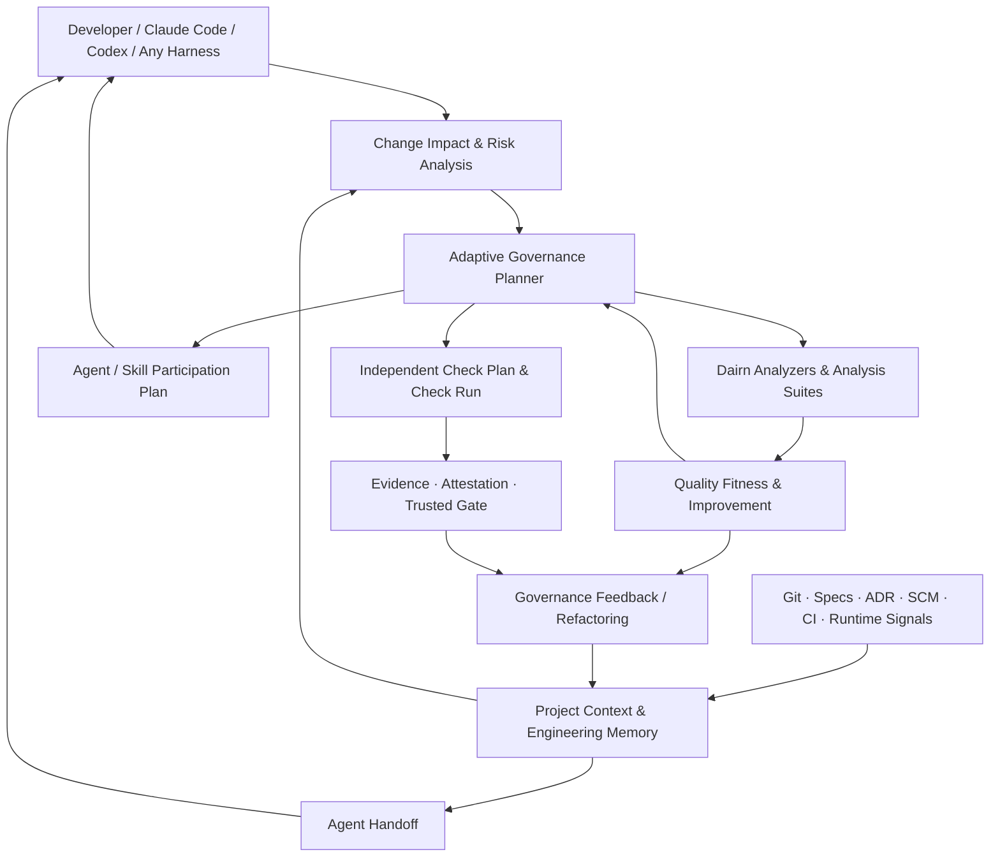

# Dairn

**Adaptive Engineering Governance for Humans and AI Agents**  
**自适应工程治理 · 可验证的质量保障 · 持续演进的项目工程记忆**

> **让任何开发者、任何 Coding Agent，都能在最小必要治理成本下持续交付、验证和改进软件。**
>
> Dairn 不接管 Agent 的推理与编码过程；它让工程约束、真实检查、质量目标、历史决策和可信证据独立于 Agent 长期存在。

[GitHub](https://github.com/moorefu/dairn) · [构建指南](BUILDING.md) · [治理指南](docs/GOVERNANCE.md) · [MIT License](LICENSE)

**项目状态（截至 2026-10-24）**：本 README 同时呈现**当前可用的 MVP** 和**目标架构**，以 2026-10-24 的 Analyzer 破坏性更名批次为代码核对基线。`[Current]` 表示已在源码中实现、有对应命令与测试；`[Planned]` 表示尚未落地，示例不可直接照搬执行。**`Dairn Analyzers` 命名已落地**：`dairn analyzers`、`.dairn/analyzers.json`（`dairn.analyzers.v1`）、`guide impact --analyzer`；旧 `stubs` 命令、`.dairn/stubs.json`、`dairn-stub-v1` 协议与 `DAIRN_EXPECTED_STUBS_SHA256` 已全部删除，**无兼容层、无自动迁移**。本文不宣称 GitHub 受保护 CI 已在本仓库生产部署。

---

## 为什么需要 Dairn？

AI 编程工具正在迅速增强。它们能读懂仓库、修改代码、运行测试，也能通过 Skills 和 Subagents 引入架构师、安全审计、测试、性能优化等专业能力。但一个软件项目的长期质量不能只依靠某个 Agent 的上下文和自我报告：

- **改动是否合理**：对一个 README 拼写修改和对支付协议的修改，不能要求相同的审查与测试成本。
- **保障是否充分**：测试通过，不一定代表公共接口、架构边界、数据安全或性能契约依然成立。
- **结果是否可信**：Agent 声称“已经检查通过”，不等于真实 CI 执行，更不等于独立人工批准。
- **知识是否连续**：Agent、开发者、仓库结构不断变化，过去的设计取舍、失败教训和技术债需要保留其来源与有效性。
- **治理是否值得**：治理不能只增加流程、报告、等待时间和维护负担；必须证明它带来了实际的质量与效率收益。

**Dairn 的回答不是再做一个 Agent Harness，而是在现有 Harness、Git、CI、SCM 与工程工具之上建立一层轻量、可验证、可演进的工程治理。**

### Dairn 与 Agent Harness 的边界

| Agent Harness（Claude Code、Codex 等） | Dairn |
| --- | --- |
| 组织模型推理、工具调用、上下文与代码修改 | 分析变更、约束风险、制定验证要求 |
| 选择并执行 Skills / Subagents | 判断何时需要哪些专业能力，给出参与计划 |
| 执行命令并汇报结果 | 验证检查记录、证据来源和适用范围 |
| 优化当前任务的完成过程 | 保护跨 Agent、跨 PR、跨版本的长期工程质量 |

Dairn **不调用大模型、不替换 IDE、不接管代码修改、不另建 Agent 推理循环**。没有 AI Agent，它也应该可以运行确定性检查并验证工程事实。

## 核心理念

1. **Minimum Sufficient Governance（最小充分治理）**：只执行当前风险与受信策略确实要求的保障，不把每个任务变成完整流程。
2. **Evidence over Claims（证据优于声明）**：记录真实执行、输入范围、工具与报告摘要；不把自然语言结论当成机器证明。
3. **One Source of Truth（单一事实源）**：代码属于 Git，审批属于 SCM，构建事实属于 CI，设计决策属于受控 Specs/ADR；Dairn 提供引用与派生视图，不复制第二套状态账本。
4. **Agent-Agnostic（不绑定 Agent）**：Claude Code、Codex、其他 Harness、人类开发者都可以消费相同的治理信息。
5. **Quality Improvement, Not Score Chasing（质量改进而非刷分）**：保护架构不变量、检测回归、观察趋势，连同治理开销一起衡量实际收益。
6. **Composable, Optional Workflow（可组合、按需协作）**：Check、Analyzer、Handoff 等基础能力独立可用；Work、Grill、Spec 和专项 Review 按任务需要加入。

---

## 整体架构（目标形态）



图中包含已实现与规划能力；具体成熟度见下表。图中的反馈关系不是一个允许 Quality 或 Agent 覆盖受信 Policy 的循环：**策略下限由受信来源决定，Quality 和 Agent 只能提供观测、缺口与改进建议。**

### 当前能力成熟度

| 能力 | 状态 | 现有入口 / 说明 |
| --- | --- | --- |
| Cosmopolitan QuickJS APE、npm/PyPI/离线分发、项目 Launcher | **[Current]** | CLI 与运行时资产、可离线使用 |
| 项目 `init` / `adopt` / `detect` / `doctor` / `validate` | **[Current]** | 项目接入、完整性与结构检查 |
| Specs、Skills、Workflow 建议、Facts / Git Impact | **[Current]** | `docs`、`skills`、`workflow`、`guide` |
| 风险分类与独立 Check / Run Evidence | **[Current]** | `scope`、`check`、`evidence` |
| Gate、Approval、Ed25519 Attestation 与发布辅助脚本 | **[Current — deployment verification pending]** | 代码有独立验证链；生产信任还取决于真实受保护 CI/SCM 配置 |
| 零仪式 Agent 交接 | **[Current · MVP]** | `handoff`，不需 `.dairn/` 或 Work |
| **Adaptive Governance Planner** | **[Current · MVP]** | `governance plan/explain`：最小保障计划、真实缺口、模块×检查矩阵 |
| **Capability Assessment 与仓库发现** | **[Current · MVP]** | `governance assess`、`adopt --discover --plan`；工具可见性不等于执行成功 |
| **Refactor Contract 与已知债务比较** | **[Current · MVP]** | `refactor plan/status/compare/verify`；部分退出条件需专项证明 |
| **Governance Feedback** | **[Current · MVP]** | `governance recommend`：基于历史 Run 生成**待验证假设**，不自动调规则 |
| 可选 Work / Tasks、Hooks、Grill/Review 工作指导 | **[Current]** | 不应成为普通变更运行 Check 的前提 |
| **Dairn Analyzers（surface 域）** | **[Current · 原子更名完成]** | `analyzers list/templates/doctor/init`、`guide impact --analyzer`；`.dairn/analyzers.json`（`dairn.analyzers.v1`）；旧 `stubs` 接口已删除、无兼容层 |
| **Analysis Suite / `analyze run`** | **[Current · MVP]** | `analyze run <id> | --suite <id>`：串行执行、`dairn.analysis-run.v1` 记录（completed/tool-error/timeout/…），失败不冒充成功 |
| **Report Adapters 与报告导入** | **[Current · MVP]** | `analyze import`：SARIF 2.1.0 / JUnit XML / Dairn JSON → `dairn.quality-observation.v1`，来源恒为 `unverified-import` |
| **Quality Fitness** | **[Current · MVP]** | `quality fitness`：`dairn.quality-goals.v1` 目标 × 本地 Observation → PASS/FAIL/UNKNOWN/ADVISORY；缺数据绝不猜 PASS |
| **Quality Fitness & Continuous Improvement** | **[Current · MVP]** | 可信基线比较、Coverage XML/LCOV 适配、长期趋势与债务收益 |
| **Capability-Aware Agent / Skill Participation** | **[Current · MVP]** | 触发面扩展（影响事件、检查失败）、输出契约消费与成本预算 |
| **Project Engineering Memory 的完整 Context Resolver** | **[Planned]** | 来源索引、当前适用性、任务/专业定向上下文；已有事实和 Handoff 是基础 |

> **测试与部署状态**：基线前一提交 `61d1db7` 的提交说明报告“容器 141 项回归通过，原生五组测试退出码 0”；基线提交 `0e62a11` 本身是 CI Windows 环境中 Git 2.56 升级引发的集成回归修复，未附带新的容器回归记录。以上均为提交作者的测试记录，**不是本 README 的独立复测结论**。本仓库当前 `main` 仍未开启分支保护，Rulesets 为空；提交 CI 模板、Signer/Publisher 代码本身不构成已经上线的受保护证据链。

---

## 快速开始：当前可用功能

### 安装

Dairn 的 CLI 命令名为 `dairn`。npm 包为 [`@moorefu/dairn`](https://www.npmjs.com/package/@moorefu/dairn)（unscoped `dairn` 曾被 npm 以与既有包过于相似为由拒绝），PyPI 包为 [`dairn`](https://pypi.org/project/dairn/)。

| 渠道 | 安装示例 | 环境 |
| --- | --- | --- |
| npm | `npm install -D @moorefu/dairn` | Node.js 18+ |
| npm 预发布 | `npm install -D @moorefu/dairn@next` | Node.js 18+ |
| PyPI | `python -m pip install dairn` | Python 3.10+ |
| PyPI 预发布 | `python -m pip install --pre dairn` | Python 3.10+ |
| GitHub Release | [下载对应平台的离线制品](https://github.com/moorefu/dairn/releases)（APE/ZIP/tgz/Wheel） | 自带 APE 与启动器 |

如果尚未发布正式版本，请使用预发布通道，或在 Releases 中选择实际存在的版本；**安装命令不代表对应版本当前一定已在注册表发布**。建议生产环境固定精确版本并校验制品摘要。

npm 本地安装可使用 `npx dairn` 调用，或通过 `npm exec -- dairn` 运行已安装版本。项目初始化后，优先使用项目内 Launcher，而不是让 Agent 临时安装一个全局版本。

### 试用零仪式交接：`handoff`

在**已有 Git 仓库**中运行：

```sh
# PATH / npm 已安装版本
npx --no-install dairn handoff

# 显式指定 Git 基线
npx --no-install dairn handoff --base origin/main

# 适合 Agent 解析的结构化输出
npx --no-install dairn handoff --json
```

`handoff` MVP 不需要 `.dairn/`、不需要 Work、默认不写入文件、不联网，也不执行测试。它可总结当前分支和 HEAD、最近变更、staged/unstaged/untracked 文件、当前本地可见的检查证据、阻塞信息与建议，并标明数据来源和限制。

也可以显式输出文件：

```sh
npx --no-install dairn handoff --out .dairn/tmp/handoff.md
```

此输出是**只读交接摘要，不是 CI 证明或正确性保证**。它无法读取编辑器中尚未保存的内容，也不会凭空知道其他设备上尚未同步的工作。

### 初始化一个示例项目

```sh
# 先确认 CLI 已安装（此处的 dairn 指已安装的命令）
dairn version

# 创建一个 Go 示例项目
dairn init --root ./demo --name demo --stack go --sample

# 初始化后通过项目内 Launcher 执行
a=./demo/.dairn/bin/dairn
"$a" doctor --root ./demo
"$a" validate --root ./demo
"$a" check --root ./demo --all
```

在 Windows 下使用 `demo\.dairn\bin\dairn.cmd`。检查会使用项目配置的真实工具链；Go 普通测试可能需要 Go 工具链，Go race/CGO 不属于默认验收。

### 接入已有项目：先发现，再决定是否写入

先在 Git 仓库中观察项目，不要让 Dairn 直接覆盖现有 README、CI 和工程配置：

```sh
# 本地 Dairn 命令已安装；以下在目标仓库根目录执行
dairn detect --root .

# 新增：只读探测技术栈、已有 CI 标志、测试工具标记，并输出接入计划
dairn adopt --root . --discover --plan

# 明确检查计划后，再决定是否真正接入
dairn adopt --root .

# 接入后优先调用项目内 Launcher
./.dairn/bin/dairn doctor --root .
./.dairn/bin/dairn validate --root .
./.dairn/bin/dairn guide impact --base origin/main --root .
```

`adopt --discover --plan` **不写入仓库**；扫描到 `go.mod`、`pom.xml` 或 `.github/workflows/` 只表示存在这些文件，**不代表测试命令已可运行**。`adopt` 写入模式应先在工作分支审阅变更；已经由 Dairn 管理的项目使用 `upgrade --plan`，而不是再次 adopt。

### 现在即可试用 Adaptive Governance [Current · MVP]

下面命令在**已接入 Dairn、具有 Git Commit、能解析 `origin/main` 的目标仓库**内执行。项目内 Launcher 负责定位固定版本；`--base` 是本地存在的 Git Ref，可以使用明确的提交 SHA。

```sh
# 显示风险、必须覆盖的模块×检查、可本地快跑的项、必须留给 CI 的项
dairn governance plan --base origin/main

# 解释每项保障需求的来源；计划本身不代表任何 Check 已通过
dairn governance explain --base origin/main

# 机器可读，便于 Harness 按需读取
dairn governance plan --base origin/main --json

# 检查当前环境是否发现了所需工具（不是实际验证通过）
dairn governance assess --risk L2 --json

# 运行真实的项目 Check；应在完成本次改动后执行
dairn check --base origin/main

# 只读交接：连带最近本地证据的来源、陈旧和不确定性
dairn handoff --base origin/main --json
```

**Git 的影响范围要以已提交变更为准。** 当前 Planner 使用 `base..HEAD` 的路径作为输入：未提交的工作区变更不会自动出现在该 Plan 的 `change_paths` 中；提交或正确限定 Source 后再评估。`handoff` 则会显示工作区的 staged/unstaged/untracked 路径，两者用途不同。

`governance plan` 的 `ready-to-execute` 仅表示所需执行器已经配置，不等于检查通过；`governance assess` 的 `detected` 仅表示命令入口可探测，不等于测试已运行，也不等于 `ci-verified`。强制放行必须由可信 Check、Evidence、SCM 和 CI 证明。

### 可选：从现有运行记录观察治理成本 [Current · MVP]

```sh
# 默认查看近期历史；可显式指定整数天数，如 90
dairn governance recommend --window 90 --json
```

当 Check Run 样本不足时返回 `insufficient-evidence`，**不会硬凑出推荐**。当前反馈实现会提出慢检查、重复运行及高失败比例相关假设；失败比例并不能单独证明 Flaky，必须进一步核实根因后才能修改策略，且不会自动削弱检查要求。

---

## 当前执行能力与长期目标如何协作

Dairn 当前已能生成治理计划、运行真实 Check、核查工具链、保持重构契约并提供 Handoff。未来增加 Analyzer / Fitness / Agent Participation 后，将由统一的保障需求驱动，而非强制执行一条固定的多 Agent 流程。

**当前可执行的最短路径 [Current]：**

```sh
dairn handoff --base origin/main
dairn governance plan --base origin/main
dairn governance assess --risk L1
dairn check --base origin/main
```

**当前可用的新分析命令：**

```sh
# 分析器目录、模板接入与显式 surface 精确影响分析
dairn analyzers list
dairn analyzers init --template python --id py-api --apply
dairn guide impact --base origin/main --analyzer py-api

# 受控执行：生成 advisory Analysis Run（不是 Check Run）
dairn analyze run py-api --base origin/main
dairn analyze run --suite service-quality --base origin/main

# 只读导入已有报告（SARIF/JUnit/Dairn JSON；恒为 unverified-import）
dairn analyze import ci-sarif --artifact reports/security.sarif

# 质量目标 vs 本地观察的 advisory 判定
dairn quality fitness --json

# 专业能力参与建议（不启动任何模型）
dairn capability plan --base origin/main
```

**仍属目标 [Planned] 的命令：**

```sh
# 依据长期目标的可信基线比较（当前 Fitness 为 local-only）
dairn quality fitness --base origin/main --trusted-baseline

# 定向交接项目工程记忆（现有 handoff 尚无 --for）
dairn handoff --for security.threat-analysis
```

| 变更场景 | 现在可直接试用 | 目标能力增强 [Planned] |
| --- | --- | --- |
| README / 文档小改 | L0 计划 + 实际 lint；无强制 Work | 自动文档 Fitness，减少无意义专家调用 |
| 普通功能 / Bug Fix | L1 计划、Check、Workflow/Skills、Handoff | API/测试分析器、质量基线与任务定向上下文 |
| 鉴权、支付、协议修改 | L2 完整检查矩阵、SCM 审批要求 | 安全分析器 + 威胁建模能力参与 |
| 分阶段跨模块重构 | Refactor Contract、已知债务/新增回归区分 | 架构 Fitness、迁移趋势和债务收益分析 |
| 多 Agent 接手 | 真实 Git 状态与本地证据交接 | 按专业能力检索有效架构决策与质量记忆 |

**原则：Plan 决定应做什么；Analyzers/Check 负责产生事实；Quality Fitness 判断质量目标；Agent 只负责专业执行；可信 Gate 独立计算是否可放行。**

## Adaptive Governance：从风险出发，而不是从流程出发

Dairn 将**变更风险**、**治理深度**和**交互成本**分开处理：

| 维度 | 含义 | 不代表什么 |
| --- | --- | --- |
| `L0 / L1 / L2` | 变更风险等级及最低保障 | 不是 Agent 的信心评分 |
| `G0 / G1 / G2 / G3` | 治理深度；G3 面向重大事件/事故 | 不是组织成熟度 |
| Zero-ceremony / Guided / Assured | 交互方式和实际需要的流程支持 | 不是放宽安全约束的开关 |

例如，高风险变更可以不创建 Work Ledger，但不能因此跳过必要的 CI 或审批。

### Governance Planner [Current · MVP]

确定性的 `dairn.governance-plan.v1` 已实现。当前它从项目策略、Git 变化、模块重要性和已登记的 Refactor Contract 生成所需保证条件，并形成可以解释的计划。

```text
Project Policy + Git base..HEAD + Module Context
         + Approved Refactor Contracts
                       │
                       ▼
            Governance Plan v1
                       │
      ┌────────────────┼────────────────┐
      ▼                ▼                ▼
Required Checks    Execution Phase   Capability Gaps
(module×check)     local-fast / CI    + SCM Approval
```

示例（摘录字段，仅演示结构，不代表某次真实运行）：

```json
{
  "schema": "dairn.governance-plan.v1",
  "classification": {
    "risk_floor": "L2",
    "effective_risk": "L2",
    "governance_mode": "G2"
  },
  "requirements": [
    {"id": "api.lint", "module_id": "api", "check_id": "lint", "required": true},
    {"id": "api.unit", "module_id": "api", "check_id": "unit", "required": true},
    {"id": "api.integration", "module_id": "api", "check_id": "integration", "required": true},
    {"id": "api.build", "module_id": "api", "check_id": "build", "required": true}
  ],
  "execution": {
    "local_fast": ["api.lint", "api.unit"],
    "ci_required": ["api.lint", "api.unit", "api.integration", "api.build"]
  },
  "status": "ready-to-execute"
}
```

计划内容通过 `plan_sha256` 绑定身份。**这是输出结构示意，非可直接提交的完整 Schema**。当前规划器重点覆盖 Check 和 Refactor 契约；Quality Goals、Analyzer 和专业 Agent 参与的自动合成仍待实现。

不可混淆的保障边界：

- `L0/L1/L2` 表示受信策略决定的变更风险下限；不能靠 Agent 自报低风险降级。
- 默认本地快速候选是 `lint`、`unit`；完整 `ci_required` 不因本地跳过而减少。
- 每个模块的每项必需检查必须分别满足；缺少执行器返回 `MISSING_CAPABILITY`。
- `work_required: false` 只是说明 Check 无需 Work Ledger；它**不免除真实验证或必要的 SCM 审批**。
- Planner 本身只输出计划及项目配置来源信息；不会因为输出 `ready-to-execute` 就赋予可信 CI 权限。

未来将增加 Quality Goal 和 Incident/Organization 的约束合成，但受信策略始终是最低下限。

## Dairn Analyzers：传统工程工具的统一执行入口 [Current · surface 域已落地]

**Analyzer 是唯一正式的工程分析扩展单元。** 原子更名已完成：`dairn stubs` 命令、`.dairn/stubs.json`（`schema:1`/`surface-analysis`/`dairn-stub-v1`）与 `DAIRN_EXPECTED_STUBS_SHA256` 全部移除，出现旧配置即报 `UNSUPPORTED_LEGACY_ANALYZER_CONFIG`，无别名、无自动迁移。当前版本执行 `domain=surface` 的公共接口分析；报告适配与 Suite 编组属于后续批次。

典型接入对象包括：

| 分析领域 | 可复用的现有工具或技术 | 产出 |
| --- | --- | --- |
| 源码接口 | Go AST、Python `ast`、Java/TypeScript 项目分析脚本 | 公共符号与签名变化 |
| 静态质量 | ESLint、Pylint、Checkstyle、SpotBugs、Clippy | 规则发现、复杂度、可维护性 |
| 架构约束 | ArchUnit、依赖图与模块规则 | 违例、循环依赖、禁止路径 |
| 测试 | JUnit、pytest、Go test、契约测试 | 通过、失败、跳过及范围 |
| 覆盖率 | JaCoCo、Coverage.py、LCOV、Cobertura | 行/分支覆盖及分子分母 |
| 安全 | Semgrep、CodeQL 生成的报告、依赖扫描 | 风险发现与定位 |
| 性能 | Benchmark JSON、负载与基准测试 | 延迟、吞吐、资源消耗与测量条件 |

Dairn 不重新实现上述工具的全部分析算法。它统一管理可用性、执行边界、输入身份、报告适配、原始摘要和分析结果。

### Analyzer 配置（当前实际格式）

**以下 JSON 是当前实现的 `dairn.analyzers.v1` 配置**（由 `analyzers init --apply` 生成；`report`/`scope`/`inputs` 等字段属于后续的 Runner/Adapter 批次，尚未实现）：

```json
{
  "schema": "dairn.analyzers.v1",
  "analyzers": [
    {
      "id": "surface",
      "domain": "surface",
      "mode": "execute",
      "capabilities": ["quality.surface-diff"],
      "execution": {
        "argv": ["go", "run", "tools/dairn/analyzers/go/main.go"],
        "cwd": ".",
        "timeout_seconds": 120
      }
    }
  ]
}
```

项目分析配置统一放在 `.dairn/analyzers.json`，项目分析脚本放在 `tools/dairn/analyzers/`。分析请求为 `dairn.analyzer-request.v1`，响应为 `dairn.surface-result.v1`；受信 CI 环境要求外部固定的 `DAIRN_EXPECTED_ANALYZERS_SHA256`。

```sh
dairn analyzers templates                      # 查看 Python/JavaScript/Java/Shell 模板
dairn analyzers init --template python --id py-api --apply
dairn analyzers doctor                         # 只探测本地工具链
dairn guide impact --base origin/main --analyzer py-api
```

### Analysis Run 不等于 Check Run

Analyzer 的执行和结果分三层：

1. **Analysis Run**：证明 Dairn 观察到了什么执行、什么退出状态、什么报告文件及输入快照。
2. **Quality Observation**：由适配器对 SARIF、JUnit、Coverage、Dairn JSON 等报告进行标准化，保留规则、范围、样本和原始证据引用。
3. **Fitness Verdict / Trusted Gate**：结合受信目标和检查矩阵判断是否满足要求；此层不能由 Analyzer 自己决定。

工具成功退出 **不代表** 零发现；报告缺失 **不代表** 零漏洞或 100% 覆盖率。外部导入报告若没有可信来源证明，不能自动提升为 `ci-verified`。

## Quality Fitness & Continuous Improvement [Current · MVP]

`dairn quality fitness` 已落地：读取可选的 `.dairn/governance/quality-goals.json`（`dairn.quality-goals.v1`），对目标的 producer analyzer 现场执行或导入，输出 `dairn.quality-fitness.v1` 判定（PASS/FAIL/UNKNOWN/ADVISORY）。退出码：required FAIL → 1，required 数据不足 → 3。判定是**质量层 advisory 结论**，PASS 从不构成放行；required 目标的最终放行仍需可信 Check/Evidence/CI 链。

质量不能简化为一个“优秀程度得分”。Dairn 将质量目标分为三种：

| 类型 | 保护对象 | 默认处理 |
| --- | --- | --- |
| **Architecture / Security Invariant** | 明确不允许破坏的架构与安全边界 | 在具备可信检查能力后可设为强制 |
| **Regression Constraint** | 新增严重发现、行为兼容、性能退化 | 需要可比较的基线与充分样本 |
| **Trend / Technical Debt** | 复杂度、耦合、重复、修改热点、技术债 | 默认观察趋势与给出建议 |

### Quality Goals 示例

**目标协议示例（未实现）：**

```json
{
  "schema": "dairn.quality-goals.v1",
  "objectives": [
    {
      "id": "check-work-independence",
      "attribute": "modularity",
      "type": "invariant",
      "metric": "architecture.no-path",
      "parameters": { "from": "checks", "to": "work" },
      "producer": "core-dependency",
      "enforcement": "required"
    },
    {
      "id": "complexity-trend",
      "attribute": "maintainability",
      "type": "trend",
      "metric": "complexity.cognitive.max",
      "producer": "complexity-analyzer",
      "enforcement": "advisory"
    }
  ]
}
```

这里的 `producer` 只指向 Analyzer，**不意味着 Analyzer 可以自行设置风险下限或批准 PR**。强制性来自受信 Policy 与 Governance Plan。

Quality Fitness 关注**架构约束是否仍然成立、与历史相比是否引入新问题、重构是否真正降低长期成本**。对复杂度、覆盖率等代理指标，必须考虑工具版本、规则集、统计范围、环境与采样方法；不可比较时应返回 `UNKNOWN` 而不是制造改善结论。

### 渐进重构与技术债 [Current · MVP]

`Refactor Contract` 已经可以跨 PR 记录**重构范围、行为基线、允许的过渡债务和退出条件**。它对适用变更**只增加**保证要求，不能降低 L2 风险。

```sh
# 定义/审查重构契约。contract.json 是下面示例的项目文件。
dairn refactor plan --id decouple-core --file contract.json

# 明确允许写入时，再添加到 .dairn/governance/refactors/
dairn refactor plan --id decouple-core --file contract.json --apply

# 查看状态及对照既有 Check Run 的债务基线
dairn refactor status --id decouple-core
dairn refactor compare --id decouple-core --run <run-id>

# 退出条件中未能由当前本地 Run 验证的部分会报告 needs-review
dairn refactor verify --id decouple-core --run <run-id>
```

例如以下契约声明重构将保持行为、消除旧模块调用方（示例中的 `baseline.source_commit` 必须替换为**真实 Git 完整 SHA**）：

```json
{
  "schema": "dairn.refactor.v1",
  "id": "decouple-core",
  "intent": "behavior-preserving",
  "baseline": {
    "source_commit": "<full-git-sha>",
    "contracts": ["unit", "integration"]
  },
  "target": {"properties": ["legacy-callers-removed"]},
  "migration": {
    "strategy": "incremental",
    "exit_conditions": ["no-new-failures-beyond-baseline", "no-legacy-callers"]
  },
  "debt": {"allowed_transitional_items": [], "known_failures": []},
  "paths": ["src/legacy/"]
}
```

Dairn 将已知失败和**本次新增失败**区分为 `within-baseline / new-failures / signature-drift`。无法仅凭本地 Run 证明的退出条件返回 `needs-review`，**不会谎称完成**。目前的契约对比以 Check Run 为基础；它还不是完整的静态技术债分析、性能回归平台，也不能取代受信 Gate。为避免误绑定，建议显式传入当前变更对应的 `--run <run-id>`，不要依赖默认历史记录选择。

**完整的质量趋势、重构收益和受控过渡质量预算仍属于 Quality Fitness 的下一阶段。**

## Capability-Aware Agent & Skill Participation [Current · MVP]

`dairn capability plan` 已落地：确定性规则把质量目标缺口与安全敏感路径映射为 `dairn.participation-plan.v1`（needs/gaps/not_selected）。必需能力无提供者时报告 GAP 并以退出码 3 提示；计划不启动模型、不授予权限、不含任何可提升信任的字段。

当某个工程保证目标不能仅靠确定性工具满足时，Dairn 计划推荐合适的专业能力：

- 架构师 Agent：跨模块边界、接口兼容、复杂依赖和重构设计。
- 测试专家 Agent / Skill：关键行为、负向场景、契约测试和质量缺口。
- 安全审计 Agent / Skill：信任边界、鉴权、支付、敏感配置和漏洞分析。
- 性能专家 Agent / Skill：有复现依据的性能回归和资源瓶颈。
- 前后端技术 Skills：适用技术栈的开发实践、测试与接口约束。

**参与决策顺序：**

```text
Required Guarantees
    ↓
Existing Verified Checks & Analyzer Observations
    ↓
Unmet Capability Requirements
    ↓
Available Skills / Agents / Tool Capabilities
    ↓
Participation Plan（原因、时机、权限、输出、成本）
    ↓
原生 Harness 自主执行或人工选择
```

优先复用已有的可信机器检查；其次使用主 Agent 已有 Skill；确实需要独立调查、专业能力或上下文隔离时，才推荐只读专家 Subagent。

**Dairn 不直接启动模型**，不会因为配置中声明存在某个安全 Agent，就认定安全工作已完成。Agent 自己写的“PASS”也不能充当受保护 CI 或 SCM 人工审批。

对于未满足的强制能力要求，输出 `GAP`；不能在找不到专家时自动降低风险级别。对于简单变更，Participation Plan 可以为空。

## Project Engineering Memory：项目自己的工程记忆

Dairn 不把工程记忆等同于“保存聊天记录”。项目真正值得长期保留的是：**可追溯的事实、历史设计取舍、架构约束、关键缺陷、真实验证结果，以及这些知识在当前代码版本中的适用性**。

| 工程记忆 | 当前权威源 / MVP 入口 | 长期目标 |
| --- | --- | --- |
| **Project Facts** | Git、源码、模块清单、Facts、`guide impact` | 版本化的来源索引、语义关联 |
| **Change & Handoff** | Git、`handoff`、可选 Work/Tasks | 按任务和专业能力裁剪上下文 |
| **Decisions & Contracts** | 维护者的 Specs/ADR、`refactor` 契约 | 有效性、冲突和适用范围检测 |
| **Assurance History** | `check` / Evidence / CI / SCM | 保留强弱来源与当前适用性 |
| **Governance Learning** | `governance recommend` 对 Run 的统计假设 | 治理调整的真实效果与审批闭环 |
| **Quality History** | 现有测试/Check Run；Analyzers 尚待落地 | Fitness 趋势、债务热点、性能基线 |

**Project Engineering Memory 是对既有权威来源的可重建视图，而不是要求开发者另填第二套 `memory.json`。** 源代码归 Git、审批归 SCM、真实 CI 归 CI、设计决策归项目原始 Specs/ADR。缓存索引只能引用原始内容及 SHA，不能自称权威。

历史决定可以保留，但旧架构图不能永久冒充当前架构约束；旧性能基准也不应跨环境作为可靠比较值。未来 Context Resolver 应提供来源、Subject、摘要、有效性和不确定性标记。

```sh
# 当前可用：获取 Git 变化、本地 Run 证据与已有相关文件引用
dairn handoff --base origin/main --json

# 目标接口 [Planned]：当前尚不可调用
dairn context --module payment
dairn context --change origin/main
dairn handoff --for security.threat-analysis
```

## Check · Evidence · Attestation · Trusted Gate

这一层是 Dairn 与一般 Agent 流程建议的重要区别：**把「做过什么检查」与「能否据此放行」分开**。

```text
Trusted Policy / Required Checks
                ↓
Independent Check Execution
                ↓
Check Run + Subject + Input Snapshot
                ↓
Evidence Bundle + Raw Digests
                ↓
Isolated Attestation Verification
                ↓
SCM-native Approval + Trusted Gate
```

当前已有独立 Check、Run Evidence、Bundle、签名验证 CLI 和 Gate 代码；**正式可信结果还依赖组织实际配置和验收的受保护 CI、外部固定策略/工具链、受隔离签名密钥和原生 SCM 审批**。签名证明来源绑定，不证明软件绝对正确。

### 证据与信任分层

| 状态或来源 | 可以说明什么 | 不能说明什么 |
| --- | --- | --- |
| Local Observation | 本地观察到真实命令输出与文件摘要 | 不能代替受保护 CI |
| Imported Analysis Report | 读取了格式正确的报告及其原始内容 | 不能自行宣称报告来自受信 CI |
| Protected CI Evidence | 在受信环境执行或验证了策略所要求的检查 | 不能证明未覆盖行为绝对正确 |
| Verified Attestation | 使用外部受信公钥验证了声明与绑定 | 不能自动代替 SCM 人工审批 |
| SCM-native Human Approval | SCM 确认了符合规则的真实授权人 | 不能代替必需机器 Check |

`FAIL` 或缺少必需证据时，不能降格成“Agent 判断可以继续”。对于来源无法确定的情况，可信 Gate 应保持 `INDETERMINATE`，并在强制 CI 中以非成功退出处理。

### 对 CI / SCM 的职责边界

Dairn 支持以现有 GitHub / GitLab 等 SCM 原生机制作为审批事实源；不复制一套“谁批准了 PR”的内部账本。`ci/templates/` 中的受保护 CI 工作流模板需要由部署方真正接入、配置分支保护和证据信任根之后，才能宣称生产级保障。

## 治理反馈与自适应迭代 [Current · MVP]

`governance recommend` 现在能够读取项目本地历史 Check Run，针对**运行耗时、重复执行和失败频率**提出谨慎的优化建议。其历史统计不证明因果关系，也不会修改受信策略。

```sh
dairn governance recommend --window 90 --json
```

- 当历史样本少于当前实现要求时返回 `insufficient-evidence`，不会推断质量收益。
- 能给出 `CI_SLOW`、`REPEATED_RUNS`、`POLICY_NOISE` 之类的**待调查提案**，但不会修改策略。
- `POLICY_NOISE` 来自失败频率；**失败次数或失败率本身不等于已证明 Flaky 或误报**。
- 去重建议必须保留原始必需检查的可信证明，不能用本地缓存冒充 Protected CI。
- 目前只基于本地可读 Run 进行统计；真实缺陷逃逸、返工时长、A/B 效果和跨 CI Provider 的长期评价仍待建设。

完整的 Continuous Improvement 目标是同时衡量**质量收益与治理代价**，持续删除低价值的工作流步骤与重复检查，而不是不断累积更多规则。

## 工作流是可选的，不是工程事实的前提

Dairn 已提供 Skills、Specs、`workflow recommend`、Grill、Tasks、Work、Review、Hooks 和文档同步能力。它们适合复杂设计、长周期重构、跨会话协作，不应成为每次改动的前置手续。

```sh
# 返回建议的阶段与 Skills，不启动其他 Agent
dairn workflow recommend "修复支付接口重试时的状态错乱"

# 选用已有 Skills；不是强制使用
dairn skills catalog

dairn skills list

# 可选：针对明确的长期任务记录阶段和证据
dairn work list
```

**最小路径**：`Edit → Check → (required Review) → CI/SCM`。

**复杂变更可增加**：`Orient → Resolve Decisions → Specify → Slice → Implement → Review → Synchronize`。

重要区别：`workflow recommend` 当前按任务描述的关键词给出静态建议，**不是**已经完成的 Capability-Aware Agent Participation Planner。Agent 自述和 Work 状态不能替代实际 Check / Evidence / SCM 审批。

## 与 Claude Code、Codex 和其他开发环境集成

Dairn 尽量通过普通 CLI、JSON、Markdown、`AGENTS.md` 和 `SKILL.md` 交换信息，而不要求所有 Harness 使用同一种 SDK。

- **Claude Code**：可以读取 `CLAUDE.md` / `AGENTS.md` 与项目 Skills，按需使用 Dairn 的命令和结果。
- **Codex**：可以读取 `AGENTS.md` 和 Skills，根据 JSON / Markdown 结果调整具体执行步骤。
- **其他 Harness**：能调用 CLI、读取报告和遵守工程规则即可接入。
- **传统开发者/CI**：无需 Agent 也可执行检查、查看 Handoff、消费未来质量报告。

Harness 原生的文件与网络权限、工具授权和 Subagent 调度不由 Dairn 替代。第三方 Skill、报告和仓库中的指令文本应按不可信输入处理，不能自动获得更高权限。

## 推荐的目标项目结构

以下是按需启用后的**示意结构**，不是初始化一定生成所有文件。

```text
my-project/
├── AGENTS.md                         # 项目自己的 Agent 导航
├── CLAUDE.md                         # 可选的 Harness 入口
├── README.md
├── docs/
│   ├── PROJECT_GUIDE.md              # 项目事实与导航
│   ├── GOVERNANCE_SPEC.md            # Dairn 规范导航
│   └── adr/                          # 可选：长期设计决策
├── .agents/
│   ├── skills/                       # 按需引入的 Skills
│   └── notes/                        # 可选：重要决策与经验
├── .dairn/
│   ├── bin/                          # 项目内 Launcher
│   ├── lock.json                     # 运行时/资产身份
│   ├── launcher.json                 # Launcher 解析信息
│   ├── governance/
│   │   ├── project.json              # 当前项目 Policy 基础
│   │   ├── adaptation.json           # 可选：治理适配（规划）
│   │   ├── quality-goals.json        # 可选：质量目标（规划）
│   │   ├── refactors/                # 可选：渐进重构契约（当前 MVP）
│   │   └── capabilities.json         # 可选：能力映射（规划）
│   ├── analyzers.json                # Analyzer Registry（规划）
│   ├── work/                         # 可选任务协作资料
│   ├── cache/                        # 可删除、可重建的派生缓存
│   └── tmp/                          # 临时报告和上下文
└── tools/dairn/analyzers/            # 项目自有分析包装器（规划）
```

**单事实源原则**：提交的是规范与必要的配置；扫描结果、临时运行文件、缓存和 Handoff 派生输出不应无条件全部提交。默认将 `.dairn/cache/`、`.dairn/tmp/` 排除在版本控制之外。是否留存可信 Evidence 应遵照组织的受信存储与保留策略。

## 在无网络环境使用

Dairn 的运行内核使用 Cosmopolitan QuickJS APE。安装包携带运行时与完整性信息，项目可以选择 Vendored 模式，将已验证的运行时固定在仓库中。

目标项目的 Launcher 解析顺序为：

1. 用户显式指定的 `DAIRN_BIN`；
2. 项目内 `.dairn/runtime/dairn-embedded.com`；
3. `PATH` 中的 `dairn`；
4. 都不可用时，报告 `DAIRN_NOT_AVAILABLE`，不自行联网安装。

```sh
# 已有 Dairn 项目，在项目根目录预置官方受信运行时与摘要文件后：
dairn upgrade --root . --vendor-runtime .dairn/runtime --apply

# POSIX：以后通过项目 Launcher 运行
./.dairn/bin/dairn doctor
```

Windows 请使用 `.dairn\bin\dairn.cmd`。具体离线制品、平台限制、完整性校验和操作说明参见 [构建指南](BUILDING.md)。

**Agent 安全规则**：Launcher 缺失或版本校验失败时，应报告环境阻塞；Agent 不应绕过项目约定，在后台安装另一版本 Dairn 或修改全局环境。

---

## 设计中的安全与可靠性约束

- **信任必须分层**：`analysis completed`、`quality passed`、`CI verified`、`human approved` 是不同的事实。
- **PR 不能自我降低门禁**：强制检查、组织质量下限和签名信任根必须来自受信策略，不能接受当前变更对自己的宽免。
- **Analyzer 必须安全执行**：argv 数组、无隐式 Shell、执行时限、报告大小限制、路径和 Symlink 校验、输入快照、源文件意外修改检测。配置声明 `read-only` 不等于真实沙箱。
- **必须区分工具执行失败和发现问题**：扫描工具的非零退出码需要明确解释；报告缺失、未执行、过期或不可比较不能算 PASS。
- **不以质量总分代替质量目标**：架构不变量、行为契约、性能与维护性应分维度评价，并考虑测量口径。
- **专业 Agent 默认建议模式**：没有自动启动模型、自动扩大权限或使用 AI 投票替代 SCM Review 的特权路径。
- **工程记忆有时效性**：历史决定可保留，但只有仍被当前 Spec、代码及事实支持的约束才能称为当前有效。
- **治理也应被治理**：记录多余步骤、误报、耗时、计算成本和无效专家参与，持续减少治理技术债。

## 路线图

| 方向 | 最新状态 | 重点下一步 |
| --- | --- | --- |
| Project Bootstrap / Skills / Workflow / Work | **[Current]** | 优化零仪式 UX、减少强制流程依赖 |
| Independent Check / Evidence / Attestation / Gate | **[Current — 需真实部署验收]** | Protected CI/SCM 配置、端到端签名和发布验收 |
| Handoff | **[Current · MVP]** | 带验证来源的定向上下文、过期检测 |
| **Adaptive Governance Planner** | **[Current · MVP]** | 融合 Quality Goal / Analyzer Requirement；证明自适应减少无谓执行 |
| **Capability Assessment** | **[Current · MVP]** | 安全、无副作用的命令发现与真实执行能力区分 |
| **Refactor Contract / Technical Debt Baseline** | **[Current · MVP]** | 契约检查执行器、Subject/Run 与 Gate 强绑定，质量趋势 |
| **Governance Feedback** | **[Current · MVP]** | 纠正 Flaky 推断、引入缺陷/返工/成本实证与 A/B |
| **Dairn Analyzers** | **[Current · A-01]** | Runner/Suite/Report Adapter 与 `analyze run`/`analyze import` |
| **Quality Fitness & Continuous Improvement** | **[Planned]** | 架构 Fitness、SARIF/JUnit/Coverage 导入、质量基线与趋势 |
| **Capability-Aware Agent & Skill Participation** | **[Planned]** | 发现专业能力、按需参与的建议和输出契约 |
| **Project Engineering Memory / Context Resolver** | **[Planned，已有部分基础]** | 来源/适用性索引、跨 Agent 有效上下文、拒绝陈旧事实 |

**优先级原则**：先验证真实受保护 CI 的信任边界和现有 Planner/Gate 约束一致性，再将新增 Quality 指标绑定到强制门禁。Analyzer 的只读执行与 Agent Capability Discovery 可并行推进。Analyzer 命名已落地（`dairn analyzers`）；**旧 `stubs` 接口已删除，无兼容层**。

### 小试牛刀：建议先做五个场景

不必先部署完整质量平台，也无需启用所有 Skills。建议在隔离分支或临时项目中，以相同 CI 与工程工具做对照：

| 场景 | 操作 | 应观察的证据 | 试点问题 |
| --- | --- | --- | --- |
| **L0 最小治理** | README 提交后 `governance plan --base <sha>` | Risk L0，极少额外阶段与必需检查 | 小改动是否没有多余仪式？ |
| **L2 不可降级** | 修改认证/协议文件，执行 `governance plan/explain` | 完整检查矩阵、SCM 人工审批需求 | 高风险保障是否被保留？ |
| **能力缺口** | 在隔离项目中故意移除必需检查执行器，运行 `governance plan` | `MISSING_CAPABILITY`、非成功状态 | 缺配置是否会被误认为通过？ |
| **渐进重构** | 新建 `refactor` 契约并运行 `compare/verify` | 已知失败与新增失败分开，退出条件不明时报 `needs-review` | 是否能管理跨 PR 技术债？ |
| **跨 Agent 接手** | 本地修改、运行检查后执行 `handoff --json` | Git HEAD/工作区指纹、Run 来源与陈旧标记 | 是否减少重复摸索？ |

补充运行 `governance assess` 和 `governance recommend`，分别观察**当前能力是否真的可用**、**样本不足时是否拒绝得出过度结论**。

参照已编写的试点方案做真实任务 A/B，至少记录：总体耗时、返工、回归缺陷、等待时间、CI 资源消耗、接手时间和治理维护工作量。**Dairn 的成功标准不是调用更多 Agent 或输出更多报告，而是以更低的总体成本保持或改善工程保证。**

---

## 从源码构建与测试

**注意**：本仓库本身是 Dairn 源码，不是一个已经 `dairn init` 的目标项目。不要在源码根目录直接使用目标项目的 Launcher，也不要把构建输出提交为源码。

```sh
# 需要 Python 3.10+ 和项目规定的构建环境
python tools/build.py

# 或者
npm run build

# POSIX：运行源码构建出的 CLI
./dairn.sh version
./dairn.sh docs check
```

Windows 使用 `dairn.cmd`。更改 `quickjs/core/`、`quickjs/host/` 或 `quickjs/main.mjs` 后，需要重新构建运行时才能验证新源码；否则可能误测旧产物。

`quickjs.lock.json` 固定 QuickJS 运行时来源。构建涉及的完整步骤、离线缓存、平台矩阵和验证命令，参见 [BUILDING.md](BUILDING.md)。

核心实现与资源：

| 路径 | 说明 |
| --- | --- |
| `quickjs/core/` | Dairn 确定性治理逻辑 |
| `quickjs/host/` | QuickJS Host 的文件、进程与平台接口 |
| `quickjs/assets/specs/` | 分发的规范资源 |
| `quickjs/assets/skills/` | 分发的专业 Skills 与 Agent 导航 |
| `quickjs/tests/` | QuickJS/Python 集成与平台测试 |
| `ci/` | CI 模板、Provider 与受保护构建辅助脚本 |
| `tools/` | 构建、验证与开发工具 |

## 参与贡献

欢迎围绕以下方向讨论、提交 Issue 或 PR：

- Agent 无关的工程治理协议与 CLI 体验；
- Analyzer Runner、跨语言工具报告 Adapter 和可复用分析模板；
- 可执行 Architecture Fitness Functions、契约与性能回归验证；
- 受信 CI/SCM 证据绑定、负向测试与跨平台可靠性；
- 工程记忆、Agent Handoff、质量反馈与治理成本实证。

贡献原则：提供可运行的测试和真实观察结果；不要通过新增不必要的工作流或文档来替代确定性检查；涉及信任边界的变更必须包含失败/伪造/过期/缺失证据等负向场景。

开始前请阅读 [AGENTS.md](AGENTS.md)、[BUILDING.md](BUILDING.md) 和 [docs/GOVERNANCE.md](docs/GOVERNANCE.md)。

## 项目与许可证

- 源码：[github.com/moorefu/dairn](https://github.com/moorefu/dairn)
- 发布版本：[GitHub Releases](https://github.com/moorefu/dairn/releases)
- npm：[@moorefu/dairn](https://www.npmjs.com/package/@moorefu/dairn)
- PyPI：[dairn](https://pypi.org/project/dairn/)
- 许可证：[MIT](LICENSE)
- 内嵌组件及第三方许可：[`licenses/`](licenses/)

---

**Dairn 不追求替 Agent 做更多事情，而是帮助项目在不断变化的 Agent、团队与工具之间，持续保持明确的工程约束、可核验的真实结果和可积累的质量改进。**
