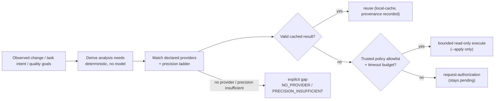

# Dairn Analyzers 与质量判定

本文覆盖 Dairn 的分析器体系：为什么存在、如何配置与执行、报告如何标准化，以及能力驱动的按需分析和质量判定（Quality Fitness）当前做到什么。治理模型与证据分层见 [ARCHITECTURE.md](ARCHITECTURE.md)。

**文档基线**：以 2026-10-24 的 Analyzer 破坏性更名批次为代码核对基线；`[Current]` 表示已实现，`[Planned]` 表示尚未落地。所有示例都是结构示意，不代表某次真实运行。

## 1. 定位：唯一正式的分析扩展单元

**Analyzer 是 Dairn 唯一正式的工程分析扩展单元。** 原子更名已完成：`dairn stubs` 命令、`.dairn/stubs.json`（`schema:1`/`surface-analysis`/`dairn-stub-v1`）与 `DAIRN_EXPECTED_STUBS_SHA256` 全部移除；出现旧配置即报 `UNSUPPORTED_LEGACY_ANALYZER_CONFIG`，**无别名、无自动迁移、无兼容层**。

Dairn 不重新实现各类工具的全部分析算法。它统一管理可用性、执行边界、输入身份、报告适配、原始摘要和分析结果。当前版本执行 `domain=surface` 的公共接口分析；`analyze run`/`analyze import`、报告适配与能力驱动的按需选择（`analyze plan`）已落地。

| 分析领域 | 可复用的现有工具或技术 | 产出 |
| --- | --- | --- |
| 源码接口 | Go AST、Python `ast`、Java/TypeScript 项目分析脚本 | 公共符号与签名变化 |
| 静态质量 | ESLint、Pylint、Checkstyle、SpotBugs、Clippy | 规则发现、复杂度、可维护性 |
| 架构约束 | ArchUnit、依赖图与模块规则 | 违例、循环依赖、禁止路径 |
| 测试 | JUnit、pytest、Go test、契约测试 | 通过、失败、跳过及范围 |
| 覆盖率 | JaCoCo、Coverage.py、LCOV、Cobertura | 行/分支覆盖及分子分母 |
| 安全 | Semgrep、CodeQL 生成的报告、依赖扫描 | 风险发现与定位 |
| 性能 | Benchmark JSON、负载与基准测试 | 延迟、吞吐、资源消耗与测量条件 |

## 2. 项目分析模板

`dairn analyzers templates` 查看可复用模板；`dairn analyzers init --template <语言> --id <id>` 默认只规划，`--apply` 才复制到 `tools/dairn/analyzers/` 并更新项目自有的 `.dairn/analyzers.json`。Dairn 不下载分析器工具链；项目可以审查、修改或替换模板。

| 模板 | 依赖与分析方式 |
| --- | --- |
| Go | Go、Git；Go AST 导出声明 |
| Python | Python 3.9+、Git；标准库 AST |
| JavaScript / TypeScript | Node.js 18+、Git；导出声明扫描，不做类型解析 |
| Java | JDK 11+、Git；公开签名扫描 |
| Rust | Cargo、serde、serde_json、Git；公开声明扫描 |
| PHP | PHP 7.4+、Git；类和函数声明扫描 |
| Lua | LuaJIT、lua-cjson、Git；函数扫描 |
| Shell | POSIX sh、jq、Git；函数声明扫描 |
| Ruby | Ruby 2.7+、Git；类、模块与方法扫描 |
| C# | .NET SDK 8+、Git；公开声明扫描 |

这些模板输出分析线索，不构成语义兼容证明或签名信任依据。`dairn analyzers doctor` 只探测本地依赖；缺少显式请求的分析器、超时或无效响应会失败。

## 3. Analyzer 配置（当前实际格式）

**以下是当前实现的 `dairn.analyzers.v1` 配置**（由 `analyzers init --apply` 生成，`mode` 取 `execute` 或 `import`；`report` 字段只用于 `mode=import` 的 SARIF/JUnit/Dairn JSON 报告导入；`execute` 当前只支持 `domain=surface`）：

```json
{
  "schema": "dairn.analyzers.v1",
  "analyzers": [
    {
      "id": "surface",
      "domain": "surface",
      "mode": "execute",
      "capabilities": ["surface.api-diff"],
      "execution": {
        "argv": ["go", "run", "tools/dairn/analyzers/go/main.go"],
        "cwd": ".",
        "timeout_seconds": 120
      }
    }
  ]
}
```

项目分析配置统一放在 `.dairn/analyzers.json`，项目分析脚本放在 `tools/dairn/analyzers/`。分析请求为 `dairn.analyzer-request.v1`，响应为 `dairn.surface-result.v1`；受信 CI 环境要求外部固定的 `DAIRN_EXPECTED_ANALYZERS_SHA256`。

```sh
dairn analyzers templates                      # 查看 Python/JavaScript/Java/Shell 等模板
dairn analyzers init --template python --id py-api --apply
dairn analyzers doctor                         # 只探测本地工具链
dairn guide impact --base origin/main --analyzer py-api
```

### 执行协议与边界

内核直接执行配置的 argv，追加绝对路径的请求和响应 JSON，**不拼接 shell 命令**。请求包含 `schema`、`analyzer_id`、`domain`（当前仅 `surface`）、`subject{source_commit,base_commit}`、`root`、`scope`、`limits`；响应回传身份并提供 `changes`。内核验证结构、路径、大小与超时。脏工作区不复用分析缓存（`.dairn/cache/analyzers/`），缓存不作为签名门禁证据。Windows 的 `.cmd/.bat` 分析器需显式经过 `cmd.exe`。配置声明 `read-only` 不等于真实沙箱。

## 4. Analysis Run 不等于 Check Run

Analyzer 的执行和结果分三层：

1. **Analysis Run**：证明 Dairn 观察到了什么执行、什么退出状态、什么报告文件及输入快照。
2. **Quality Observation**：由适配器对 SARIF、JUnit、Coverage、Dairn JSON 等报告进行标准化，保留规则、范围、样本和原始证据引用。
3. **Fitness Verdict / Trusted Gate**：结合受信目标和检查矩阵判断是否满足要求；此层不能由 Analyzer 自己决定。

`dairn analyze run <id> | --suite <id> [--base <ref>]` 受控执行分析器并生成 `dairn.analysis-run.v1` 记录（`completed`/`tool-error`/`timeout`/`report-error`/`invalidated`/`not-run`）；`dairn analyze import <id> [--artifact PATH]` 只读导入 SARIF 2.1.0 / JUnit XML / Dairn JSON 报告，来源恒为 `unverified-import`。

工具成功退出 **不代表** 零发现；报告缺失 **不代表** 零漏洞或 100% 覆盖率。外部导入报告若没有可信来源证明，不能自动提升为 `ci-verified`。

## 5. Capability 驱动的按需分析 [Current · MVP]

Analyzer 不再被无条件执行，也不再由 Agent 手工挑选。Dairn 从观察到的变更、查询意图、质量目标和受信策略中**确定性推导分析需求**，再匹配项目已声明的 provider，并按精度阶梯判断能否满足：`text < reported < heuristic < observed-static < syntax < semantic < contract`。只有被 `.dairn/governance/analysis.json` 的 `auto_execute` 白名单允许、且处于超时预算内的只读 execute analyzer，才可能在 `--apply` 时执行；默认 dry-run **不执行任何工具**。



```sh
# 默认 dry-run：只输出 needs/decisions/gaps，不执行任何工具
dairn analyze plan --base origin/main

# 仅在策略允许时执行白名单内的只读 analyzer；其余决策仍待授权；--out 写 JSON 副本
dairn analyze plan --base origin/main --apply --json --out .dairn/tmp/analyzer-plan.json
```

策略文件 `.dairn/governance/analysis.json`（`dairn.analysis-policy.v1`；文件缺失即安全默认 `auto_execute: []`，不会自动执行任何工具）：

```json
{
  "schema": "dairn.analysis-policy.v1",
  "auto_execute": ["py-api"],
  "max_timeout_seconds": 120,
  "reuse": true,
  "required": [
    {"capability": "contract.compatibility", "when": "surface-change"}
  ]
}
```

`required` 的 `when` 取 `always`/`change`/`surface-change`/`downstream-change`，可选 `precision` 只能抬高该 capability 的精度下限，不能降低内置要求。未知键、非法枚举与符号链接指向的策略文件一律 fail closed（退出码 2），不会静默退回默认值。

三条边界必须同时成立：**自动发现不等于自动安装**（不安装依赖、不下载二进制、不修改环境）；**自动选择不等于无条件执行**（只有白名单内、有界、只读的 execute analyzer 才可能自动运行）；**“无需分析器”不豁免必需检查**（缺失 provider 时输出显式缺口，绝不静默通过或伪造 PASS）。

**当前限制（诚实说明）：** 本版本仅 `domain=surface` 的 execute analyzer 可执行，其余 capability 由项目自定义 provider 提供或显式列为缺口；精度是 provider 声明的类别，Dairn 无法证明其真的达到 `syntax`/`semantic`；builtin facts 仍有界，动态派发、生成代码与反射可能漏报；缓存失效保守（工作区脏即失效）；`plan` 是 advisory，其 `status` 不是门禁结论。

## 6. Quality Fitness [Current · MVP]

`dairn quality fitness` 读取可选的 `.dairn/governance/quality-goals.json`（`dairn.quality-goals.v1`），对目标的 producer analyzer 现场执行或导入，输出 `dairn.quality-fitness.v1` 判定（PASS/FAIL/UNKNOWN/ADVISORY）。退出码：required FAIL → 1，required 数据不足 → 3。判定是**质量层 advisory 结论**，PASS 从不构成放行；required 目标的最终放行仍需可信 Check/Evidence/CI 链。

质量目标分为三种：

| 类型 | 保护对象 | 默认处理 |
| --- | --- | --- |
| **Architecture / Security Invariant** | 明确不允许破坏的架构与安全边界 | 在具备可信检查能力后可设为强制 |
| **Regression Constraint** | 新增严重发现、行为兼容、性能退化 | 需要可比较的基线与充分样本 |
| **Trend / Technical Debt** | 复杂度、耦合、重复、修改热点、技术债 | 默认观察趋势与给出建议 |

目标示例（`dairn.quality-goals.v1` 当前已实现；`operator`/`threshold` 可选、只允许 `<=`/`>=`/`<`/`>`/`==`，`producer` 指向 Analyzer id）：

```json
{
  "schema": "dairn.quality-goals.v1",
  "objectives": [
    {
      "id": "check-work-independence",
      "attribute": "modularity",
      "type": "invariant",
      "metric": "architecture.no-path",
      "producer": "core-dependency",
      "enforcement": "required"
    },
    {
      "id": "complexity-trend",
      "attribute": "maintainability",
      "type": "trend",
      "metric": "complexity.cognitive.max",
      "operator": "<=",
      "threshold": 40,
      "producer": "complexity-analyzer",
      "enforcement": "advisory"
    }
  ]
}
```

这里的 `producer` 只指向 Analyzer，**不意味着 Analyzer 可以自行设置风险下限或批准 PR**。强制性来自受信 Policy 与 Governance Plan。对复杂度、覆盖率等代理指标，必须考虑工具版本、规则集、统计范围、环境与采样方法；不可比较时应返回 `UNKNOWN` 而不是制造改善结论。

## 7. 当前不做的事

- 不实现完整静态分析器、性能回归平台或语义索引；这些通过 Analyzer/provider 接入并保留来源与精度。
- 不把 Analysis Run、Quality Observation 或 Fitness Verdict 冒充 Check Run 或可信 Gate。
- 不自动安装工具链、不下载分析器、不修改项目环境。
- 不用质量总分替代分维度的质量目标；缺数据时输出 UNKNOWN，而不是猜测 PASS。

## 报告导入边界

Import Analyzer 的 Doctor 不探测执行器，argv/cwd 为 null。Suite 可混合 execute/import，按注册模式逐项执行或导入；导入失败记为 report-error，继续处理后续项，整体返回非零退出码。导入结果保持 unverified-import 来源。

JUnit 仅接受扁平 testsuites → testsuite → testcase → failure/error/skipped 结构，支持单/双引号属性与标准 XML 声明。每个 testsuite 必须显式提供 tests/failures/errors/skipped，并与 testcase 子节点一致；testsuites 提供的汇总计数也须一致。重复属性、残缺 XML、未知节点、实体声明、CDATA 或计数矛盾均拒绝，Fitness 将缺失观测判为 UNKNOWN。

Dairn JSON 导入最多接受 500 个 findings 或 surface changes、100 个 metrics；超过上限报错，不静默截断。
