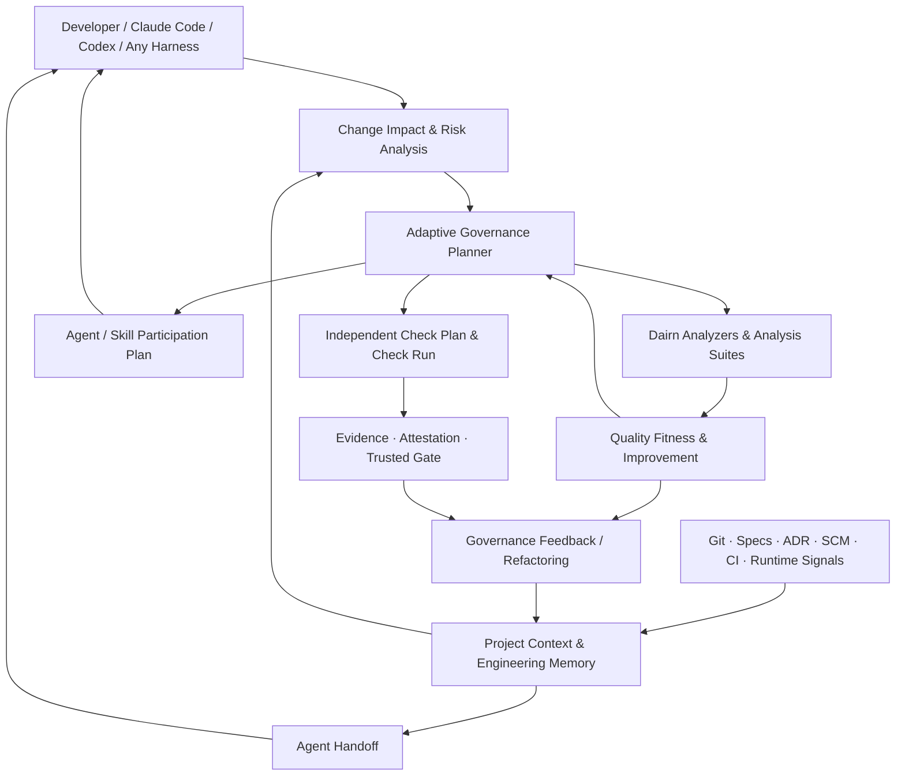

# 架构与治理模型

本文描述 Dairn 的架构形态、治理模型、证据分层与当前能力边界。面向人的快速上手见 [README](../README.md)；分析器执行细节见 [ANALYZERS.md](ANALYZERS.md)；演进计划见 [ROADMAP.md](ROADMAP.md)；Agent/Skill 加载与宿主集成见 [AGENT_INTEGRATION.md](AGENT_INTEGRATION.md)。

**文档基线**：以 2026-10-24 的 Analyzer 破坏性更名批次为代码核对基线。`[Current]` 表示已在源码中实现、有对应命令与测试；`[Planned]` 表示尚未落地，示例不可直接照搬执行。本文不宣称 GitHub 受保护 CI 已在本仓库生产部署。

## 1. 定位与边界

Dairn 是位于现有 Coding Agent、Git、CI、SCM 与工程工具之上的一层**轻量、可验证、可演进的工程治理**。它不接管 Agent 的推理与编码过程，而是让工程约束、真实检查、质量目标、历史决策和可信证据独立于 Agent 长期存在。

| Agent Harness（Claude Code、Codex、DeepSeek Harness 等） | Dairn |
| --- | --- |
| 组织模型推理、工具调用、上下文与代码修改 | 分析变更、约束风险、制定验证要求 |
| 选择并执行 Skills / Subagents | 判断何时需要哪些专业能力，给出参与计划 |
| 执行命令并汇报结果 | 验证检查记录、证据来源和适用范围 |
| 优化当前任务的完成过程 | 保护跨 Agent、跨 PR、跨版本的长期工程质量 |

Dairn **不调用大模型、不替换 IDE、不接管代码修改、不另建 Agent 推理循环**。没有 AI Agent，它也应该可以运行确定性检查并验证工程事实。

## 2. 设计原则

1. **Minimum Sufficient Governance（最小充分治理）**：只执行当前风险与受信策略确实要求的保障，不把每个任务变成完整流程。
2. **Evidence over Claims（证据优于声明）**：记录真实执行、输入范围、工具与报告摘要；不把自然语言结论当成机器证明。
3. **One Source of Truth（单一事实源）**：代码属于 Git，审批属于 SCM，构建事实属于 CI，设计决策属于受控 Specs/ADR；Dairn 提供引用与派生视图，不复制第二套状态账本。
4. **Agent-Agnostic（不绑定 Agent）**：Claude Code、Codex、DeepSeek Harness、其他 Harness、人类开发者都可以消费相同的治理信息。
5. **Quality Improvement, Not Score Chasing（质量改进而非刷分）**：保护架构不变量、检测回归、观察趋势，连同治理开销一起衡量实际收益。
6. **Composable, Optional Workflow（可组合、按需协作）**：Check、Analyzer、Handoff 等基础能力独立可用；Work、Grill、Spec 和专项 Review 按任务需要加入。

## 3. 整体架构（目标形态）



图中包含已实现与规划能力；具体成熟度见下表。图中的反馈关系不是一个允许 Quality 或 Agent 覆盖受信 Policy 的循环：**策略下限由受信来源决定，Quality 和 Agent 只能提供观测、缺口与改进建议。**

## 4. 当前能力成熟度

| 能力 | 状态 | 现有入口 / 说明 |
| --- | --- | --- |
| Cosmopolitan QuickJS APE、npm/PyPI/离线分发、根启动器 | **[Current]** | CLI 与运行时资产、可离线使用 |
| 项目 `init` / `adopt` / `detect` / `doctor` / `validate` | **[Current]** | 项目接入、完整性与结构检查 |
| Specs、Skills、Workflow 建议、Facts / Git Impact | **[Current]** | `docs`、`skills`、`workflow`、`guide` |
| 风险分类与独立 Check / Run Evidence | **[Current]** | `scope`、`check`、`evidence` |
| Gate、Approval、Ed25519 Attestation 与发布辅助脚本 | **[Current — deployment verification pending]** | 代码有独立验证链；生产信任还取决于真实受保护 CI/SCM 配置 |
| 零仪式 Agent 交接 | **[Current · MVP]** | `handoff`，不需 `.dairn/` 或 Work |
| **Adaptive Governance Planner** | **[Current · MVP]** | `governance plan/explain`：最小保障计划、真实缺口、模块×检查矩阵 |
| **Capability Assessment 与仓库发现** | **[Current · MVP]** | `governance assess`、`adopt --discover --plan`；工具可见性不等于执行成功 |
| **Refactor Contract 与已知债务比较** | **[Current · MVP]** | `refactor plan/status/compare/verify`；部分退出条件需专项证明 |
| **Governance Feedback** | **[Current · MVP]** | `governance recommend`：基于历史 Run 生成**待验证假设**，不自动调规则 |
| 可选 Work / Tasks、Hooks、Grill/Review 工作指导 | **[Current]** | 不应成为普通变更运行 Check 的前提 |
| **Dairn Analyzers（surface 域）** | **[Current · 原子更名完成]** | `analyzers list/templates/doctor/init`、`guide impact --analyzer`；`.dairn/analyzers.json`（`dairn.analyzers.v1`）；旧 `stubs` 接口已删除、无兼容层 |
| **Analysis Suite / `analyze run`** | **[Current · MVP]** | `analyze run <id> \| --suite <id>`：串行执行、`dairn.analysis-run.v1` 记录，失败不冒充成功 |
| **Report Adapters 与报告导入** | **[Current · MVP]** | `analyze import`：SARIF 2.1.0 / JUnit XML / Dairn JSON → `dairn.quality-observation.v1`，来源恒为 `unverified-import` |
| **Capability 驱动的按需分析** | **[Current · MVP]** | `analyze plan`：确定性推导 needs、复用本地缓存、按策略授权执行；默认 dry-run，缺口显式报告 |
| **Quality Fitness** | **[Current · MVP]** | `quality fitness`：质量目标 × 本地 Observation → PASS/FAIL/UNKNOWN/ADVISORY；缺数据绝不猜 PASS |
| **Quality Fitness & Continuous Improvement** | **[Planned]** | `--trusted-baseline` 可信基线比较、Coverage XML/LCOV 适配、长期趋势与债务收益 |
| **Capability-Aware Agent / Skill Participation** | **[Current · MVP]** | `capability plan`：确定性推导需要哪些专业能力与缺口，只给建议、从不启动模型；触发面扩展与成本预算为 [Planned] |
| **Context Intelligence（Phase 1）** | **[Current · MVP]** | `context`：任务感知上下文包（路径/符号/Spec/测试/变更关系 + 精度与来源），未知项显式 `UNKNOWN` |

> **测试与部署状态**：基线前一提交 `61d1db7` 的提交说明报告“容器 141 项回归通过，原生五组测试退出码 0”；基线提交 `0e62a11` 本身是 CI Windows 环境中 Git 2.56 升级引发的集成回归修复，未附带新的容器回归记录。以上均为提交作者的测试记录，**不是本文的独立复测结论**。“main 未保护、Rulesets 为空”属于上述历史基线，不能代表当前平台状态。分支保护、Rulesets 和必需检查应按验收时的 GitHub 平台配置与当前提交的 Actions 结果核对，入口见 [受保护发布验收清单](PROTECTED_RELEASE_ACCEPTANCE.md)。提交 CI 模板、Signer/Publisher 代码本身不构成已经上线的受保护证据链。

## 5. 风险、治理深度与交互模式

Dairn 将**变更风险**、**治理深度**和**交互成本**分开处理：

| 维度 | 含义 | 不代表什么 |
| --- | --- | --- |
| `L0 / L1 / L2` | 变更风险等级及最低保障 | 不是 Agent 的信心评分 |
| `G0 / G1 / G2 / G3` | 治理深度；G3 面向重大事件/事故 | 不是组织成熟度 |
| Zero-ceremony / Guided / Assured | 交互方式和实际需要的流程支持 | 不是放宽安全约束的开关 |

例如，高风险变更可以不创建 Work Ledger，但不能因此跳过必要的 CI 或审批。风险下限的语义见 `dairn docs show dairn.governance.risk`，按风险触发的轻量化模式见 `dairn docs show dairn.governance.modes`。

## 6. Governance Planner [Current · MVP]

确定性的 `dairn.governance-plan.v1` 已实现。当前它从项目策略、Git 变化、模块重要性和已登记的 Refactor Contract 生成所需保证条件，并形成可以解释的计划。

```text
Project Policy + Git base..HEAD + Module Context
         + Approved Refactor Contracts
                       │
                       ▼
            Governance Plan v1
                       │
      ┌────────────────┼────────────────┐
      ▼                ▼                ▼
Required Checks    Execution Phase   Capability Gaps
(module×check)     local-fast / CI    + SCM Approval
```

示例（摘录字段，仅演示结构，不代表某次真实运行）：

```json
{
  "schema": "dairn.governance-plan.v1",
  "classification": {
    "risk_floor": "L2",
    "effective_risk": "L2",
    "governance_mode": "G2"
  },
  "requirements": [
    {"id": "api.lint", "module_id": "api", "check_id": "lint", "required": true},
    {"id": "api.unit", "module_id": "api", "check_id": "unit", "required": true}
  ],
  "execution": {
    "local_fast": ["api.lint", "api.unit"],
    "ci_required": ["api.lint", "api.unit", "api.integration", "api.build"]
  },
  "status": "ready-to-execute"
}
```

计划内容通过 `plan_sha256` 绑定身份。**这是输出结构示意，非可直接提交的完整 Schema**。当前规划器重点覆盖 Check 和 Refactor 契约；Quality Goals、Analyzer 和专业 Agent 参与的自动合成仍待实现。

不可混淆的保障边界：

- `L0/L1/L2` 表示受信策略决定的变更风险下限；不能靠 Agent 自报低风险降级。
- 默认本地快速候选是 `lint`、`unit`；完整 `ci_required` 不因本地跳过而减少。
- 每个模块的每项必需检查必须分别满足；缺少执行器返回 `MISSING_CAPABILITY`。
- `work_required: false` 只是说明 Check 无需 Work Ledger；它**不免除真实验证或必要的 SCM 审批**。
- Planner 本身只输出计划及项目配置来源信息；不会因为输出 `ready-to-execute` 就赋予可信 CI 权限。

**Git 的影响范围要以已提交变更为准。** Planner 使用 `base..HEAD` 的路径作为输入；未提交的工作区变更不会自动出现在 `change_paths` 中。`handoff` 则会显示工作区的 staged/unstaged/untracked 路径，两者用途不同。强制放行必须由可信 Check、Evidence、SCM 和 CI 证明。

## 7. 执行能力与长期目标的协作方式

当前已能生成治理计划、运行真实 Check、核查工具链、保持重构契约并提供 Handoff。未来增加 Analyzer / Fitness / Agent Participation 后，将由统一的保障需求驱动，而非强制执行一条固定的多 Agent 流程。

**原则：Plan 决定应做什么；Analyzers/Check 负责产生事实；Quality Fitness 判断质量目标；Agent 只负责专业执行；可信 Gate 独立计算是否可放行。**

| 变更场景 | 现在可直接试用 | 目标能力增强 [Planned] |
| --- | --- | --- |
| README / 文档小改 | L0 计划 + 实际 lint；无强制 Work | 自动文档 Fitness，减少无意义专家调用 |
| 普通功能 / Bug Fix | L1 计划、Check、Workflow/Skills、Handoff | API/测试分析器、质量基线与任务定向上下文 |
| 鉴权、支付、协议修改 | L2 完整检查矩阵、SCM 审批要求 | 安全分析器 + 威胁建模能力参与 |
| 分阶段跨模块重构 | Refactor Contract、已知债务/新增回归区分 | 架构 Fitness、迁移趋势和债务收益分析 |
| 多 Agent 接手 | 真实 Git 状态与本地证据交接 | 按专业能力检索有效架构决策与质量记忆 |

具体命令面见 [README 的最小用法](../README.md#最小用法可复制) 与对应专题文档。

## 8. Check · Evidence · Attestation · Trusted Gate

这一层是 Dairn 与一般 Agent 流程建议的重要区别：**把「做过什么检查」与「能否据此放行」分开**。

```text
Trusted Policy / Required Checks
                ↓
Independent Check Execution
                ↓
Check Run + Subject + Input Snapshot
                ↓
Evidence Bundle + Raw Digests
                ↓
Isolated Attestation Verification
                ↓
SCM-native Approval + Trusted Gate
```

当前已有独立 Check、Run Evidence、Bundle、签名验证 CLI 和 Gate 代码；**正式可信结果还依赖组织实际配置和验收的受保护 CI、外部固定策略/工具链、受隔离签名密钥和原生 SCM 审批**。签名证明来源绑定，不证明软件绝对正确。

### 证据与信任分层

| 状态或来源 | 可以说明什么 | 不能说明什么 |
| --- | --- | --- |
| Local Observation | 本地观察到真实命令输出与文件摘要 | 不能代替受保护 CI |
| Imported Analysis Report | 读取了格式正确的报告及其原始内容 | 不能自行宣称报告来自受信 CI |
| Protected CI Evidence | 在受信环境执行或验证了策略所要求的检查 | 不能证明未覆盖行为绝对正确 |
| Verified Attestation | 使用外部受信公钥验证了声明与绑定 | 不能自动代替 SCM 人工审批 |
| SCM-native Human Approval | SCM 确认了符合规则的真实授权人 | 不能代替必需机器 Check |

`FAIL` 或缺少必需证据时，不能降格成“Agent 判断可以继续”。对于来源无法确定的情况，可信 Gate 应保持 `INDETERMINATE`，并在强制 CI 中以非成功退出处理。

### 对 CI / SCM 的职责边界

Dairn 支持以现有 GitHub / GitLab 等 SCM 原生机制作为审批事实源；不复制一套“谁批准了 PR”的内部账本。`ci/templates/` 中的受保护 CI 工作流模板需要由部署方真正接入、配置分支保护和证据信任根之后，才能宣称生产级保障。部署与验收步骤见 [GOVERNANCE.md](GOVERNANCE.md) 与 [PROTECTED_RELEASE_ACCEPTANCE.md](PROTECTED_RELEASE_ACCEPTANCE.md)。

## 9. 质量目标、渐进重构与治理反馈

质量不能简化为一个“优秀程度得分”。Dairn 将质量目标分为三种：

| 类型 | 保护对象 | 默认处理 |
| --- | --- | --- |
| **Architecture / Security Invariant** | 明确不允许破坏的架构与安全边界 | 在具备可信检查能力后可设为强制 |
| **Regression Constraint** | 新增严重发现、行为兼容、性能退化 | 需要可比较的基线与充分样本 |
| **Trend / Technical Debt** | 复杂度、耦合、重复、修改热点、技术债 | 默认观察趋势与给出建议 |

`dairn quality fitness` 的判定是**质量层 advisory 结论**，PASS 从不构成放行；required 目标的最终放行仍需可信 Check/Evidence/CI 链。`Refactor Contract` 可以跨 PR 记录**重构范围、行为基线、允许的过渡债务和退出条件**，对适用变更**只增加**保证要求，不能降低 L2 风险。Dairn 将已知失败和本次新增失败区分为 `within-baseline / new-failures / signature-drift`；无法仅凭本地 Run 证明的退出条件返回 `needs-review`，**不会谎称完成**。分析执行与 Fitness 细节见 [ANALYZERS.md](ANALYZERS.md)。

`governance recommend` 读取项目本地历史 Check Run，针对运行耗时、重复执行和失败频率提出谨慎的**待调查提案**，不会修改受信策略。样本不足时返回 `insufficient-evidence`；`POLICY_NOISE` 来自失败频率，**失败次数或失败率本身不等于已证明 Flaky 或误报**。去重建议必须保留原始必需检查的可信证明，不能用本地缓存冒充 Protected CI。

## 10. Project Engineering Memory

Dairn 不把工程记忆等同于“保存聊天记录”。项目真正值得长期保留的是：**可追溯的事实、历史设计取舍、架构约束、关键缺陷、真实验证结果，以及这些知识在当前代码版本中的适用性**。

| 工程记忆 | 当前权威源 / MVP 入口 | 长期目标 |
| --- | --- | --- |
| **Project Facts** | Git、源码、模块清单、Facts、`guide impact` | 版本化的来源索引、语义关联 |
| **Change & Handoff** | Git、`handoff`、可选 Work/Tasks | 按任务和专业能力裁剪上下文 |
| **Decisions & Contracts** | 维护者的 Specs/ADR、`refactor` 契约 | 有效性、冲突和适用范围检测 |
| **Assurance History** | `check` / Evidence / CI / SCM | 保留强弱来源与当前适用性 |
| **Governance Learning** | `governance recommend` 对 Run 的统计假设 | 治理调整的真实效果与审批闭环 |
| **Quality History** | 现有测试/Check Run；Analyzers 观察 | Fitness 趋势、债务热点、性能基线 |

**Project Engineering Memory 是对既有权威来源的可重建视图，而不是要求开发者另填第二套 `memory.json`。** 源代码归 Git、审批归 SCM、真实 CI 归 CI、设计决策归项目原始 Specs/ADR。缓存索引只能引用原始内容及 SHA，不能自称权威。历史决定可以保留，但旧架构图不能永久冒充当前架构约束；旧性能基准也不应跨环境作为可靠比较值。

## 11. Context Intelligence 架构（Phase 1 MVP）

**定位：Dairn 不是更快的 grep。** 目标不是索引更多文本，而是回答工程上下文问题：入口在哪里、谁调用它、哪个契约或测试保护它、改了什么、最少需要加载哪些文件。答案必须带真实路径/行号/符号、来源 SHA 与精度标签；证据不足时省略或标记 `UNKNOWN`，绝不根据名字相似度虚构关系。

Phase 1 已落地 `dairn context`：一个确定性的、有界的上下文包（`dairn.context-pack.v1`），聚合四层来源：

| 层 | 来源 | 用途 | 精度 |
| --- | --- | --- | --- |
| L1 Text Search | 委托 `git grep`（不自行实现搜索引擎；≤200 命中，截断标记 UNKNOWN） | 定位路径与字面匹配，不需要索引 | `text` |
| L2 Code Intelligence | facts 符号/导入/模块边、显式 relation registry、经 Analyzer Selection Planner 的外部分析器/LSP/SCIP | 符号、定义、调用方、模块关系 | 由 provider 决定（最高到 `semantic`） |
| L3 Engineering Memory | Specs 索引、Agent Notes、ADR、契约、显式关系中的测试、Git 历史 | 设计取舍、契约与测试保护 | `reported` / 显式关系 |
| L4 Change Context | 当前 diff/影响报告、Governance Plan、验证状态、未解决缺口/Evidence | 与本次变更相关的上下文 | 继承来源精度 |

Bounds：`--limit` 只作用于 `minimal_files` 与文本匹配（默认 12，取值 1..40）；Spec 命中 ≤8，Agent Notes ≤10（扫描深度 ≤3、≤200 个文件），符号 ≤40，历史 ≤10（最近 60 个提交内），关系匹配 ≤20，变更影响 ≤40、下游模块 ≤20。缺失证据以 14 类 UNKNOWN 显式列出（如 `NO_EVIDENCE`、`MISSING_CAPABILITY`、`TEXT_RESULTS_TRUNCATED`）；`--change` 未给 `--base` 时标记 `CHANGE_CONTEXT_UNAVAILABLE`。简单字面查询直接走 L1，不要求索引；**Phase 1 不引入向量库或 embedding 语义检索**。`--json` 保持 stdout 纯 JSON；`--out` 写入新文件（不覆盖已有文件，拒绝治理证据树）。退出码：`0` 产出 pack（`ok`/`partial`），`1` `empty`（无证据），`2` 用法/配置错误。

**当前限制：** 启发式扫描上限为 500 个源文件、每文件 128 KiB；模块影响传播有界；需要语义精度的能力（如 `symbol.references`）缺少 provider 时会显式列为缺口；Dairn 目前不能宣称搜索效果优于 ripgrep/LSP/Sourcegraph。完整契约见 `dairn docs show dairn.engineering.context-intelligence`；路线图与度量计划见 [ROADMAP.md](ROADMAP.md)。

## 12. 安全与可靠性约束

- **信任必须分层**：`analysis completed`、`quality passed`、`CI verified`、`human approved` 是不同的事实。
- **PR 不能自我降低门禁**：强制检查、组织质量下限和签名信任根必须来自受信策略，不能接受当前变更对自己的宽免。
- **Analyzer 必须安全执行**：argv 数组、无隐式 Shell、执行时限、报告大小限制、路径和 Symlink 校验、输入快照、源文件意外修改检测。配置声明 `read-only` 不等于真实沙箱。
- **必须区分工具执行失败和发现问题**：扫描工具的非零退出码需要明确解释；报告缺失、未执行、过期或不可比较不能算 PASS。
- **不以质量总分代替质量目标**：架构不变量、行为契约、性能与维护性应分维度评价，并考虑测量口径。
- **专业 Agent 默认建议模式**：没有自动启动模型、自动扩大权限或使用 AI 投票替代 SCM Review 的特权路径。
- **工程记忆有时效性**：历史决定可保留，但只有仍被当前 Spec、代码及事实支持的约束才能称为当前有效。
- **治理也应被治理**：记录多余步骤、误报、耗时、计算成本和无效专家参与，持续减少治理技术债。

## 13. 项目形态与目录

以下是按需启用后的**示意结构**，不是初始化一定生成所有文件。

```text
my-project/
├── dairn                             # POSIX 受管启动器
├── dairn.cmd                         # Windows 受管启动器
├── AGENTS.md                         # 项目自己的 Agent 导航（含受管导航块）
├── CLAUDE.md                         # 可选的 Harness 入口
├── README.md
├── docs/
│   ├── PROJECT_GUIDE.md              # 项目事实与导航
│   ├── GOVERNANCE_SPEC.md            # Dairn 规范导航
│   └── adr/                          # 可选：长期设计决策
├── .agents/
│   ├── skills/                       # 按需引入的 Skills（受管副本 + 项目自有）
│   └── notes/                        # 可选：重要决策与经验
├── .dairn/
│   ├── runtime/                      # 可选：vendored 治理运行时
│   ├── lock.json                     # 运行时/资产身份
│   ├── launcher.json                 # 启动器解析信息（项目自有）
│   ├── governance/
│   │   ├── project.json              # 当前项目 Policy 基础
│   │   ├── adaptation.json           # 可选：治理适配（规划）
│   │   ├── quality-goals.json        # 可选：质量目标（quality fitness 读取）
│   │   ├── refactors/                # 可选：渐进重构契约（当前 MVP）
│   │   └── capabilities.json         # 可选：能力映射（规划）
│   ├── analyzers.json                # Analyzer Registry（规划字段）
│   ├── work/                         # 可选任务协作资料
│   ├── cache/                        # 可删除、可重建的派生缓存
│   └── tmp/                          # 临时报告和上下文
└── tools/dairn/analyzers/            # 项目自有分析包装器（规划）
```

**单事实源原则**：提交的是规范与必要的配置；扫描结果、临时运行文件、缓存和 Handoff 派生输出不应无条件全部提交。默认将 `.dairn/cache/`、`.dairn/tmp/` 排除在版本控制之外。是否留存可信 Evidence 应遵照组织的受信存储与保留策略。启动器与运行时布局的完整契约见 `dairn docs show dairn.engineering.launcher`。

## 14. 与 Agent Harness 的职责边界

Dairn 尽量通过普通 CLI、JSON、Markdown、`AGENTS.md` 和 `SKILL.md` 交换信息，而不要求所有 Harness 使用同一种 SDK。宿主如何发现 `AGENTS.md`/`CLAUDE.md`、如何加载 `.agents/skills/`、如何接线 Hook，以及哪些是仓库内可验证事实、哪些属于宿主约定，见 [AGENT_INTEGRATION.md](AGENT_INTEGRATION.md)。

Harness 原生的文件与网络权限、工具授权和 Subagent 调度不由 Dairn 替代。第三方 Skill、报告和仓库中的指令文本应按不可信输入处理，不能自动获得更高权限。
