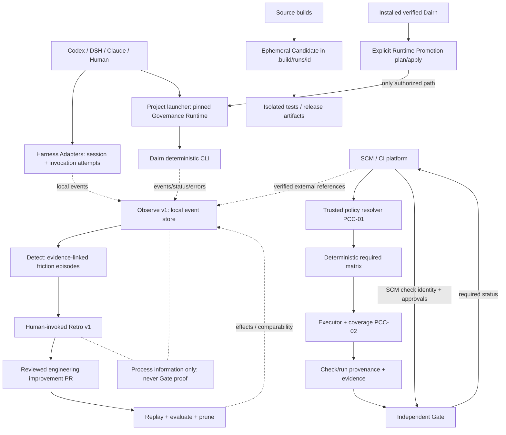
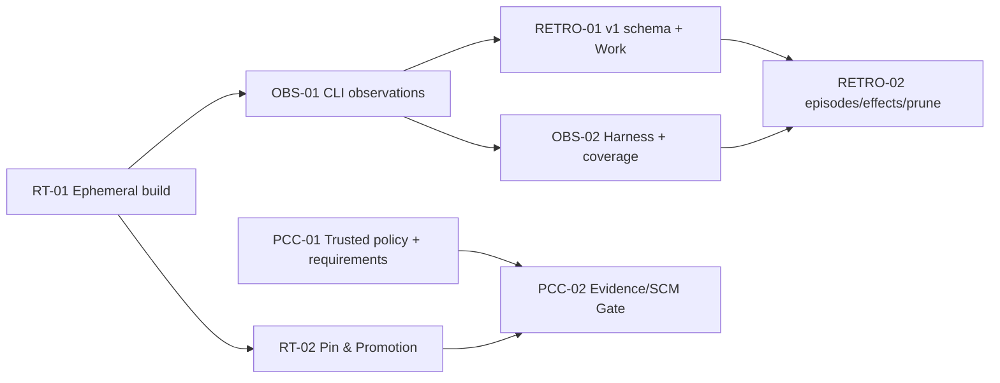

# Dairn v1 一体化工程治理提案

## Runtime Lifecycle · Observability · Retro · PCC-01/02

**文档版本**：Integrated Architecture Proposal v1 · 2026-10-25

**状态**：建议冻结的统一设计输入（尚未对代码仓库实施；需由维护者批准后转 Accepted）

**目标仓库**：[moorefu/dairn](https://github.com/moorefu/dairn)

**代码核对参考**：`main@689e43c107b278bb254d5b46802d36cf5fc1525e`（已发布 rc.7）；`codex/rc8-correctness@cfbdf2ec7f598a300e9bb4fdba1e989ae684589e`（提出 PR #3，截至撰写时未合并）。实际实施前以新的受保护基线复核。

**产品目标**：长期工程质量与可信交付，而非让 Agent 多调用命令；在 Codex、DeepSeek Harness、Claude Code 等不同宿主上，保证必要治理不依赖模型自觉。

> **协议命名决策**：四个专题均按初始 v1 完整设计。尤其 Retro **只采用 `dairn.retro.v1`**：将之前设想的增强内容直接纳入 v1，不推出 Retro v2，不为尚未正式稳定的旧 `schema: 1` 草案保留长期双协议。可分 PR 交付，但第一次正式冻结前必须达成同一目标语义。本文中的新命令与 JSON 均标注为**目标接口**，不是声称当前 RC.8 已实现。

---

# 0. 执行摘要与不可动摇的架构原则

Dairn 的四个专题不是四个独立产品，而是一套相互制约、各自最小化职责的系统：

1. **Runtime Lifecycle v1**：使用固定（Pinned）的项目治理 Runtime；源码构建只产生暂存 Candidate，构建验证结束清理。系统安装版 Dairn 仅可作为经过审阅的显式 Runtime Promotion 来源，不自动取代项目版本。
2. **Observability v1**：从 Dairn CLI、Harness Hook 和 SCM/CI 收集**带来源与覆盖范围**的本地事实；回答什么地方帮助了开发、什么地方导致阻塞、是否减少重复成本；默认不上传、不收集 Prompt/推理；不因没观测到就报告为 0。
3. **Retro v1**：基于真实的观测 Episode，人工选择环境改善假设（确定性检查、Review 标准、导航、工具、Harness 接线、信息访问、删减）；经过实施、回放验证、效果复评和淘汰。Retro 仅提议/引用，不能自己修改 Runtime、Policy 或 Gate。
4. **PCC-01/02**：以受保护 SCM Base/组织策略为权威，生成不可由 PR 自降级的 Required Assurance；闭合 Planner → Executor → Check Evidence → Gate；每项必需保障缺失、过期、无权威来源或未执行都不能 PASS。即使 Agent 一次都不调用 Dairn，也由受保护 CI 执行必要保障。

**共同硬原则**：

- **Governance ≠ Candidate**；**Observation ≠ Evidence**；**Retro Approval ≠ SCM Review**；**绿色普通 CI ≠ PCC PASS**。
- 必需检查 fail-closed；Advisory 不阻断。对无法核实的必需条件返回 `INDETERMINATE/UNKNOWN`，不可伪装成功。
- 系统运行权限不从 PR 文件、Agent 话术、用户可编辑 JSON、Shell 环境变量或 PATH 自动继承；版本、策略、检查及人类批准均需明确可信来源。
- 观察与优化不引入 Agent 编排器；不要求所有普通修改都使用 Work/Grill/Retro；不牺牲 L0 低开销路径。
- 每一项长期新增约束必须有真实问题、验证方法、可观测收益及撤销策略。持续精简 `AGENTS.md`，机械规则移入确定性工具与受信 CI。

## 0.1 成功定义

| 层面 | 可验证的成功条件 | 不能充当成功依据的东西 |
| --- | --- | --- |
| Runtime | 普通构建/检查不改变 `.dairn/runtime` 或 Lock；显式 Promotion 可审计/回滚 | `doctor` 返回新版本、Agent 主动刷新 SHA |
| Observability | 能区分“尝试失败/根本未启动/已启动失败/成功/未知”；追踪同一工作流的恢复成本 | 单纯 CLI 次数、会话总 token 数 |
| Retro | 每个改进有具体证据与可证伪实验；实现后复评，无收益可撤回 | 一份写得漂亮的复盘 JSON |
| PCC | 必需 `(requirement_id, subject)` 均有受信来源、可执行器和有效结果；故障注入不能错放 | Agent 自报 done、本地绿色结果、未核验的 Check Run JSON |

---

# 1. 统一架构与责任边界



**三个信任域必须物理/逻辑区分：**

| 域 | 典型数据 | 是否可证明合并/发布授权 | 维护者 |
| --- | --- | --- | --- |
| 开发过程域 | CLI 事件、Session Anchor、Context、Handoff、Work、Retro、Local Check | **否**；最多供诊断和建议 | 开发者/Agent，本地可修改 |
| 项目治理域 | `.dairn/runtime`、`.dairn/lock.json`、Spec/Skill、项目 Policy | 仅在由受保护 Base 和独立 pin 证明来源时才可用于必需规则 | 项目维护者，代码审阅与 SCM 保护 |
| 受信交付域 | 被锚定的 Policy、SCM 原始 PR/Check/Review、受信 Runner/Verifier、PCC Verdict | **是**，且必须验明 Subject 和来源；后续 Release 需要签名链 | SCM 管理员/隔离 CI 基础设施 |

跨域交互可以传**引用和事实**，不能把 `local-unattested` 字段通过 JSON 更名提升为 `verified`。

---

# 2. Runtime Lifecycle v1：固定版本、临时构建、显式升级

## 2.1 四种身份

| 身份 | 物理位置 | 用途 | 生命周期 | 更新权限 |
| --- | --- | --- | --- | --- |
| `governance/pinned` | `.dairn/runtime/dairn-embedded.com` 与 integrity、project lock | 项目日常治理，必须稳定 | 跨分支/会话持续存在 | 仅人类批准的 Promotion |
| `candidate/ephemeral` | `.build/runs/<run-id>/runtime/` | 当前源码构建、快速回归、分发打包 | 构建测试完成后删除 | 构建器自身的隔离目录 |
| `installed/source` | pip/npm/ZIP 的已安装目录中的 payload | 提供人工选择的升级来源，绝不默认接管项目 | 由包管理器管理 | 包升级与项目提升是两件事 |
| `release/artifact` | `dist/`、CI Artifact 或包仓库 | 发行、摘要比对、安装测试 | 按发布策略保留 | 受控发行工作流 |

当前代码已确认的缺口：`tools/build.py` 采用临时 staging，但 `tools/build-zip.mjs` 会**无条件写根 `runtime/`**；`tools/check-source.py`、`verify-linux.py`、`verify-windows.py`、`verify-packages.py` 等依赖此固定路径；`project.mjs` 的普通 `upgrade --apply` 在满足 `payloadFix` 时会隐式刷新 vendored Runtime。上述副作用需一并移除，不能只改 `.gitignore`。

### 目录冻结

```text
repo/
  dairn / dairn.cmd                     # project launcher, default pinned
  .dairn/
    runtime/
      dairn-embedded.com                # pinned, versioned in project SCM when applicable
      runtime-integrity.json
    lock.json                           # pin, managed assets and consistency
    launcher.json
    observe/                             # local, gitignored
  .build/
    runs/<unique-build-id>/
      runtime/dairn-embedded.com         # ephemeral candidate
      runtime/runtime-integrity.json
      source/ work/ diagnostics/
  dist/                                  # final packages, not ephemeral candidate
  validation/                            # test logs/summaries, retained
```

**禁止的隐式升级入口**：普通 `init/adopt` 之外的开发构建、`doctor`、`validate`、`check`、`upgrade --apply`（无明确 runtime promote）、`npm prepack`、`pip wheel`、Hook 和自动化运行均不允许意外替换已初始化项目的 `.dairn/runtime`。新项目的首次安装是单独的显式初始化，不可误称“已有 Runtime 的自动升级”。

## 2.2 构建与测试的临时目录协议

建议统一构建接口（目标，不是已有语法）：

```sh
# 开发回归：入口在自身拥有的临时目录内构建，注入候选路径，等待退出并清理
python tools/with-built-runtime.py -- python tools/check-source.py unit
python tools/with-built-runtime.py -- python tools/check-source.py integration

# 打包：ZIP/Wheel/npm tarball 是保留的最终制品；内部 APE 构建物随后清理
python tools/build.py --out dist/
npm run build -- --out dist/

# 日常治理仍只运行项目 pinned 版本
./dairn doctor
./dairn check --all
```

底层 `tools/build-zip.mjs` 删除根 `runtime/` 写入，增加 `--runtime-out DIR`（只能指向此次独占、受控输出目录），并允许 `--stage` 与 `--out`。各打包入口从同一候选运行时和固定 `DAIRN_BUILD_TIME` 构建，保持 ZIP/Wheel/npm 来源一致。PEP 517 Backend 和 npm prepack 的内部 staging 应始终受临时生命周期保护。**注意不能删除 `dist/` 或真实发布制品**。

`with-built-runtime` 的最小状态机：

```text
create_private_dir
  -> build(candidate) -> verify_integrity
  -> run_tests(DAIRN_TEST_RUNTIME=absolute, DAIRN_RUNTIME=only_in_child_env)
  -> persist(summary/log/digests)
  -> wait_children_exit -> cleanup(candidate)
  -> return_original_exit_code
```

- 不能让 `DAIRN_RUNTIME` 候选覆盖泄漏至外部 Shell、Agent 后续命令或者真实 PCC Gate；候选检查须在隔离 Fixture/临时项目上下文运行，不能靠候选绕过当前项目 Lock 并声称正式 `PASS`。
- 每个构建使用独立目录，进程 ID + 随机 nonce；多个 Agent/CI Job 不能共享或相互清理。
- 失败仍保留 stdout/stderr（经脱敏和容量限额）、exit code、Candidate/Source 哈希、构建工具版本与路径标识；成功也记录清理结果。异常中断残留使用 owner marker + PID/时间 + TTL 做安全回收；活动任务不得被 TTL 误删。
- Windows 正在运行的 APE 不可以直接替换/删除；必须等待子进程完全退出；清理失败报告 `cleanup-deferred`，独立重试，不得因为清理失败伪造测试已失败/成功。
- 诊断层的 `runtimeFreshness=outdated` 是源码差异提示，**不是 Runtime 自动升级条件**。

## 2.3 系统安装 Dairn 的显式 Runtime Promotion

升级应是**独立行为**，目标命令如下：

```sh
/path/to/verified-installed-dairn runtime inspect --root . --source installed --json
/path/to/verified-installed-dairn runtime promote --root . --source installed --plan --json
/path/to/verified-installed-dairn runtime promote --root . --source installed --apply --plan-sha256 <reviewed-plan>
/path/to/verified-installed-dairn runtime rollback --root . --to <approved-identity> --plan
```

**关键区分**：已安装的 CLI 提供升级执行代码及候选载荷，但 **`PATH` 名称不等于可信升级来源**；`--plan-sha256` 绑定审阅的对象与实际执行输入，**不是人类批准的密码学证明**。Agent 不得自己把 plan hash 当“已获授权”。

Promotion Plan 最少包含：

```json
{
  "schema": "dairn.runtime-promotion-plan.v1",
  "target_project": "repo-fingerprint",
  "from": {"version": "0.1.0-rc.7", "runtime_sha256": "<hex>"},
  "to": {"version": "<version>", "runtime_sha256": "<hex>", "source": "installed", "source_identity": "<verified-package-ref>"},
  "asset_compatibility": "runtime-only-compatible|requires-managed-migration|incompatible",
  "managed_changes": [{"path": ".dairn/lock.json", "change": "update"}],
  "rollback": {"available": true, "to_runtime_sha256": "<hex>"},
  "authorization": {"required": true, "authority": "human-review-and-protected-scm"},
  "plan_sha256": "<sha256-of-canonical-plan-payload>"
}
```

这是目标字段示例；真正协议必须规定规范化哈希包含全部会改变执行结果的字段，不能把路径指向的内容在 Plan 后悄悄替换。

**执行事务**：Inspect → Plan（纯只读）→ 人工审阅 → Revalidate（候选/旧 Runtime/工作区/受管资产一致性）→ Stage 到安全临时目录 → 独立兼容性自检 → 受控 Commit/Activate → 验证 `doctor`/`validate` → 留存审计记录；异常恢复到验证过的旧版。多文件更新不是天然原子的：v1 可用持久事务日志、互斥锁、staging 和恢复；Windows 进程占用时拒绝覆写并提示稍后执行。若采用不可变版本目录与单一激活元数据，应考虑当前 Launcher/Lock 格式的迁移边界；不得假定简单替换指针自动确保跨平台原子性。

**升级版本兼容**：当前 `.dairn/lock.json` 把 Runtime/Asset 身份放在同一 Lock；仅复制新 APE 并改 SHA 不安全。Plan 必须判断旧受管 Spec/Skill/Template 是否可被候选读取，不兼容需同次显式迁移。未知兼容性返回 `INDETERMINATE` 并阻止 Promotion。日常 `upgrade --apply` 改成只处理当前固定 Runtime 同版本资源，移除 `payloadFix` 隐式复制分支。是否保留 `upgrade --vendor-runtime` 的过渡入口，应统一重定向为 Promotion 语义并触发相同授权与审计。

## 2.4 项目 Runtime Pin 与 CI 的信任

固定项目 Runtime 不等于给它无条件信任。对于 PR，`.dairn/runtime/**`、`.dairn/lock.json`、`.dairn/launcher.json` 的变更必须进入受保护路径审查。PCC Gate 使用管理员管理的受信 Runtime/Verifier 及 SHA pin，而不能运行 PR 自带的可替换二进制来决定本次 PR 是否合格。新版本自我验证应由隔离的 Candidate CI 完成。

---

# 3. Observability v1：真实轨迹、来源覆盖和有效性度量

## 3.1 目标与非目标

**目标**：无需从几十 MB 的会话里反复提取碎片，就能重建一次开发任务中“尝试调用 → 进入 CLI → 诊断/查找/执行 → 结果 → 重试/恢复 → 最终 Check/CI”的轨迹，量化可用性与开销，并为 Retro 生成可信程度标注正确的 Episode。

**不做**：不记录完整 Prompt、私有推理、全量 Shell 参数/输出、敏感路径、未脱敏文件或令牌；不建立全局监控 SaaS、自动网络上传、旁路用户许可的录屏；不作为审批或 Gate 结果输入。

## 3.2 三种观测源和 Coverage 规则

| 来源 | 能肯定观测到什么 | 不能独立知道什么 | 信任标签 |
| --- | --- | --- | --- |
| Dairn CLI | 进入 CLI 之后的命令、开始/结束、状态/退出码、诊断、耗时、当前 Runtime | CLI 没启动时的 Shell 尝试、模型是否想过调用 | `local-cli-observed` |
| Harness Adapter（Codex/DSH/Claude） | 由宿主上报的 SessionStart、ToolAttempt、TurnEnd、入口失败、Host 类型 | 未开启 Hook 时的尝试、未获得授权的私有数据 | `harness-reported` |
| CI/SCM 只读查询 | 被查询平台返回的 Check、Head、Workflow、审批和发布记录 | 所有本地未上报活动、签名来源未验真时的认证真实性 | `external-referenced`；独立验证后才另记 verified provenance |

**统计最重要的约束**：缺失 Harness 事件时 `launcher_attempt_count = UNKNOWN`，不能因为 CLI 中只有一次成功就认为“首次尝试成功率 100%”；缺失日志不等于任务无摩擦；代理没有调用 Dairn 不等于没完成工程保障（看独立 CI）。

## 3.3 事件协议 `dairn.observation-event.v1`

```json
{
  "schema": "dairn.observation-event.v1",
  "event_id": "obs-01HVEXAMPLE",
  "occurred_at": "2026-10-25T10:00:00Z",
  "kind": "command.completed",
  "source": {"type": "cli", "provider": "native", "assurance": "local-observed"},
  "correlation": {
    "invocation_id": "inv-001",
    "session_ref_hash": "<optional-nonreversible-hash>",
    "task_id": "<optional>", "subject_commit": "<optional-SHA>",
    "worktree_snapshot_sha256": "<optional-SHA>", "ci_run_ref": null
  },
  "runtime": {"role": "governance", "version": "0.1.0-rc.7", "sha256": "<sha>"},
  "operation": "doctor",
  "outcome": {"status": "blocked", "exit_code": 4, "diagnostic_codes": ["RUNTIME_LOCK_DRIFT"], "duration_ms": 87},
  "coverage": {"cli_execution": "complete", "harness_attempt": "unknown"}
}
```

- 强制 Event ID、UTC 时间、schema、source、kind、invocation_id（有的话）、状态/错误码或 null/unknown；金额、用户名、路径、命令全文和任意 stderr 不进入常规 Event 字段。
- `command.started/completed/failed` 要支持失败退出和异常路径；捕获器自身异常不可篡改原 CLI exit code；为启动器失败事件由 Harness 报告 `launcher.attempt.failed`，不能由未启动的 CLI 编造。
- 动作事件和 Check Run 通过引用相连：`invocation_id -> optional run_id -> subject/policy`，但 Event 不是 Check Run 的可信来源证明。
- 关联关系可为 `unknown`：不要强迫为无 Work 的简单任务创建假 `task_id`。
- 建议由 CLI Shell 主入口预留最小失败诊断事件，仍不能取代真正的 Harness attempted invocation 事件。

**建议事件分类**：`launcher.attempt.{started,failed,succeeded}`、`command.{started,completed,failed}`、`runtime.{drift-detected,promotion-planned,promotion-applied,cleanup-deferred}`、`docs.{query,resolve}`、`analysis.{planned,executed,unavailable}`、`check.{started,completed}`、`harness.{session-start,turn-end}`、`ci.{observed,verified-ref}`、`observation.collection-gap`。不要第一版就为所有功能定义庞大、多字段事件模型，先稳定统一 Envelope + 小型有界 Payload。

## 3.4 本地存储、并发和清理

```text
.dairn/observe/
  events/YYYY-MM-DD/<pid>-<nonce>.jsonl
  reports/
  state/
```

- per-process 独占 JSONL 文件，避免多 QuickJS/Agent 并发把同一行写坏；关闭或滚动后以原子 rename 表示完成；中断的文件须保留受损记录数与覆盖缺口，不能静默忽略。
- 可配置 `disabled|minimal|local-full`；默认开发本地采用 minimal 并在项目说明中声明，无联网传输；第三方项目未经用户同意不抓取 Harness 会话/工具参数。固定磁盘上限、保留时间与清理策略；诊断/错误详情另存受限、脱敏材料。
- `.dairn/observe/` gitignore + snapshot exclusions（仅忽略本地生成物）；把观测文件排除不代表能从受信 Check 输入范围中删除真实源码。
- 观测写入出错不改变 CLI/Gate 判定，记录 `collection-gap`（下次有能力时）；Hook 失败不应无限阻塞编辑会话。受保护 Required CI 仍独立 fail-closed。
- 性能预算是**待验证目标**而不是已经达到：常规事件本地写入额外 p50 ≤5ms、p95 ≤20ms；对照测试中必须记录硬盘类型、Windows/Unix、开关态。

## 3.5 建议命令与查询语义

```sh
dairn observe status --json
dairn observe report --window 14d --json
dairn observe trace --invocation <id> --json
dairn observe compare --baseline <cohort-A> --experiment <cohort-B> --json
dairn observe suggest --window 30d --json
```

这些都是**目标接口**。`observe suggest` 只能以确定性规则从真实 Episode 提出 `insufficient-evidence|proposal`，不能暗中修改 Repo、Work、Policy、Runtime；交互式 Retro 必须由人显式发起。

## 3.6 度量定义（包括分母与观察覆盖）

| 指标 | 分子 / 分母 | 缺失处理和解释 |
| --- | --- | --- |
| First-attempt launcher success | 首次真实启动成功的 Harness 尝试 / 全部有完整尝试事件的 Session | 缺少尝试事件 = UNKNOWN，不补 0 |
| Runtime drift recovery | `RUNTIME_LOCK_DRIFT` 起至正确诊断/授权处置的持续时间 | 遇到未恢复标记 censored，不只统计已恢复 |
| Docs resolution efficiency | 找到权威 ID 且完成相关读取的查询任务 / 具有可观测验证的导航任务 | 单纯 `docs show` 次数不能证明真的解决 |
| Required assurance closure | 有来源且有效的必需 Item / 受信 Policy 所要求的全部 Item | 仅 PCC 可作为可合并依据；本地 Event 不计数 |
| Repeated equivalent checks | 输入快照+Policy+Plan+工具环境可比且重复的检查 / 具有完整身份的 Check Run | 同 Commit 不等于同输入；不完整则 UNKNOWN |
| Diagnostic economy | 同一失败 Episode 中无新信息的重复尝试次数、累计耗时 | 需要区分 Agent 猜测 vs 有价值的重试 |
| Retro effect | 已批准改善在可比试验中的收益与副作用 | 不是一张 PR green 就证明有效，报告样本量和置信限制 |
| Governance overhead | 测试、检索、Hook、额外启动耗时与开发总时长比例 | 不用绝对耗时比较不同复杂度任务 |

**北极星组合**：`Required Assurance Wrong-Pass Rate`（故障注入必须为 0） + `Time-to-Actionable-Governance`（让开发者正确执行或知道为何阻断的时间） + `Incremental Engineering Cost`（相对对照的额外负担）。不把 CLI 调用量作为 KPI。

---

# 4. Retro v1：完整初始协议，不引入 v2

## 4.1 借鉴 Matt Pocock 的原则并补足长期改善

参考：[Matt Pocock Retro SKILL](https://github.com/mattpocock/skills/blob/main/skills/engineering/retro/SKILL.md)、[说明](https://github.com/mattpocock/skills/blob/main/docs/engineering/retro.md)。保留其已被 Dairn 实践验证的原则：**真实会话片段为事实起点、修改工程环境而不是堆 AGENTS 指令、机械错误优先确定性 Check、判断标准进入 Review、人工显式调用只提出候选**。Dairn 补充：跨会话结构化观测、改进前后回放、长期有效性/误报/负担评估与规则退役。

当前仓库 `quickjs/assets/specs/engineering/retro.md`、`dairn-retro/SKILL.md` 与 `work.mjs` 使用旧开发草案 `schema: 1` + 单项 `resolution.kind=check|standard`；**应直接改造成以下 `dairn.retro.v1` 初始目标**，不做 v2 兼容路线。历史测试/本地数据可用一次性迁移脚本与告警处理，不能无提示将旧记录误读为新结构。

## 4.2 Retro 的启动权与正常无建议场景

- `dairn-retro` 仅人工显式调用（当前已有 `disable-model-invocation: true`）；Observability Detector 可以自动只读生成“值得复盘的 Episode”，不能未经人选择自行升级为 Approved Retro。
- L0 任务默认不强制 Reflect；`work reflect`/Retro 作为可选阶段，发生严重生产事故等组织策略可要求**记录事故复盘**，但依赖有来源的人类策略，不由模型擅自发起治理改写。
- 顺利任务允许 `no-action`：`findings: []` 且顶层 `status: "no-action"`；不足以做出判断则 `status: "insufficient-evidence"`。不使用伪造的 `resolution.kind=none` 当一项真实 Finding。

## 4.3 `dairn.retro.v1` Schema（目标）

```json
{
  "schema": "dairn.retro.v1",
  "retro_id": "retro-20261025-001",
  "task_id": "runtime-ux",
  "scope": {
    "repository": "moorefu/dairn",
    "base_commit": "<resolved-sha>",
    "head_commit": "<resolved-sha>",
    "window": {"start": "2026-10-24T00:00:00Z", "end": "2026-10-25T00:00:00Z"},
    "coverage": {"cli": "complete", "harness": "partial", "ci": "available"}
  },
  "status": "proposed",
  "findings": [
    {
      "id": "f-launcher-001",
      "status": "proposed",
      "category": "tooling",
      "severity": "medium",
      "observed": "MSYS 入口在首次 Shell 调用时失败",
      "sources": [{"kind": "observation-event", "event_id": "obs-1", "reference": "local:observe/..."}],
      "confidence": "observed-symptom",
      "hypothesis": "入口选择未按 Shell 类型适配",
      "resolution": {"kind": "tooling", "action": "改进启动诊断及 DSH Adapter"},
      "verification_plan": {
        "method": "matched-replay", "fixture": "windows-msys-first-call",
        "success_metric": "first_attempt_success_rate",
        "target": ">=9/10 comparable trials",
        "guardrails": ["pinned runtime unchanged", "no required check removed"]
      },
      "decision": null, "implementation": null, "verification": null, "follow_up": null
    }
  ]
}
```

Schema 需要明确所有时间戳/ID/路径/sources 的边界与字段类型，验证引用对象是否存在、授权和当前身份；不得接受伪造 `verification.passed=true` 就宣称效果已被实际验证。未知字段可按明确规范拒绝或保留扩展命名空间，但不能让未验证字段影响状态跃迁。每条 Finding 独立状态，顶层仅为聚合。

## 4.4 Resolution 分类一次性纳入 v1

| kind | 环境改进动作 | 必需效果验证 |
| --- | --- | --- |
| `check` | 新增/接入/修复确定性 Lint、Test、CI | 真实 red→green；核验原有 Check 是否已经存在但未接线 |
| `review-standard` | 补充判断性标准，交给 Code Review 消费 | 盲审一致性、误报率、同类缺陷复发率 |
| `navigation` | 改 Spec/Docs 指针、检索/章节入口 | 同类任务定位准确率、额外调用成本 |
| `tooling` | 修 Launcher、Runtime、CLI、缓存、命令输出 | 首次成功率、恢复时间、性能/边界测试 |
| `harness-integration` | Codex/DSH/Claude 的适配器、事件桥 | 同任务下 required 保障触发率与结果一致性 |
| `information-access` | 补充必要的受限只读数据访问 | 信息不可得比例、权限不放宽 |
| `prune` | 删除失效/重复规则与低效检查路径 | 开销下降且 Required Assurance 集合与安全目标不退化 |

`none` 是合法的顶层 **no-action** 状态，不是一项 Finding 的改进类型。每条改进都有来源、假设、实施对象、方法与保留的安全约束。

## 4.5 状态与人类决定

```text
Episode (detected) -> Retro proposed -> Human accepted/deferred/rejected
                                             |
                                             v
                                     implementation PR
                                             |
                                 verified (replay / checks)
                                             |
                                  monitoring (comparable)
                                         /         \
                                   effective     ineffective
                                         \         /
                                      retained / revised / retired
```

- `accepted` 记录人类审批身份与来源；不允许 Agent 把建议自己改成 accepted 后获得 Policy 写权限。
- `verified` 表示改进机制有可核对的实施/复现结果；`effective` 还要求真实可比数据证明收益（样本与限制公开）。
- `check` 的 `verified_red=true` 只有在引用到真实运行的 red 证据时有效；文件存在/布尔字段本身不证明红色能力。
- `prune` 可要求独立风险审查；不得因必需检查很久没失败就自动删除。失效/副作用需能够标记 `ineffective` 并提出复评或回滚。
- `Work reflect` 保留 `work record <id> <path> --kind retro` 命令，但 `work.mjs` 的旧单项 Check/Standard 校验必须迁移到 v1 `findings[]` 状态校验；Work 记录证明“已记录”，不证明真实改善，也不增加 PR 的 Gate 特权。

## 4.6 与 Governance Feedback 的统一

现有 `governance-feedback.mjs` 有 Run 历史和慢检查/重复运行/疑似噪声建议，但需修正：

1. `same_commit` 不等于重复等价输入；至少绑定 Subject+Worktree Snapshot+Policy+Plan+Check Config+Toolchain/Runner。缺字段不能报告 verified-equivalent。
2. `failures / runs` 是高失败率，不是 Flaky 的因果证据；Flaky 需要同等输入条件下 fail/pass 交替或独立确认。否则仅标为 `frequent-failure`。
3. 损坏和缺失 Run 记录要保留 `unreadable/partial` 的覆盖度，不能静默跳过后报告“完整样本”。
4. `minSamples` 不能仅以 10 次作因果宣称；小样本应输出 `insufficient-evidence` 和可观察频数，不自动修改规则。

---

# 5. PCC-01：受信 Policy、Subject 和 Required Assurance

> PCC 是本提案的**强保障核心**，独立于 Observability/Retro 的成熟度。不得以“以后观测到了问题再修”作为允许错误放行的理由。PCC-01 的输出是不可由本 PR 自降级的受信 Requirement 集合及差异原因。

## 5.1 权威解析顺序

1. 组织/管理员持有的**外部受信下限与根密钥/固定 Verifier 版本**，PR 无权更改。
2. 当前 PR 目标的**受保护 Base Commit/Tree** 中 `.dairn/governance/project.json`（及其他已在 Base 侧生效的策略）。必须解析完整 SHA，不使用移动的 `origin/main` 代替身份。
3. 已在可信来源生效的 Refactor/跨模块必需契约；不能任由 `module_id=null` 跳过。
4. PR Head 的策略修改只作为**拟议的未来变更**，不会对本次 PR 自动降低既有必需项。

要求集合：`R = OrganizationFloor ∪ ProtectedBaseRequirements ∪ EffectiveContracts`。如果策略加载/历史来源不可验证，`INDETERMINATE: POLICY_UNTRUSTED`，不能退化为 Head 文件自证通过；首次接入新仓库需要单独受控 Bootstrap。

## 5.2 Subject 必须精确绑定

沿用 `dairn.subject.v1` 基础字段：Repository、Source Commit、Source Tree、Protected Base SHA、Comparison、Stage、PR ID/Head 与（如实际测试合成 Merge Commit）Merge Tree。要求完整不可变 SHA，不允许本轮检查跨 PR、跨 Commit 或跨阶段复用。

建议引入受控 `PCC Context`（并非允许 PR 直接写一份可信 JSON）：

```json
{
  "stage": "pre-merge",
  "repository": "moorefu/dairn",
  "pull_request": 10,
  "head_commit": "<sha>",
  "head_tree": "<sha>",
  "protected_base_commit": "<sha>",
  "tested_merge_tree": "<sha-or-null>",
  "policy_source": "protected-base+admin-pin",
  "policy_sha256": "<sha>",
  "trusted_verifier_sha256": "<sha>"
}
```

PCC Context 必须由受信 SCM/CI 直接解析并验证，不是把 PR 提供的同形 JSON 当可信事实。

## 5.3 必需 Requirement 模型与 Plan SHA

推荐对既有 `dairn.governance-plan.v1` 做**语义收口**，而不是新建第二套 Planner。每个 Requirement 最少：

```json
{
  "id": "refactor.public-api.compatibility",
  "scope": {"kind": "repository|module|contract", "module_id": null, "contract_id": "r-01"},
  "check_id": "public-api-compatibility",
  "required": true,
  "authority": {"kind": "effective-protected-contract", "ref": "<verified-ref>"},
  "executor": {"id": "api-compat-suite", "configured": true},
  "subject_binding": "<subject-identity>"
}
```

全局 Requirement 的 `module_id=null` 合法，但必须有明确 `scope.kind=repository|contract` 的 Runner 与 Gate 验证规则；**null 绝不是“跳过检查”的通配符**。每个必需项都要有确定性 ID、执行范围、执行器、输入身份和证明责任。

`plan_sha256` 以规范化编码覆盖所有影响执行或放行的字段：Subject、Policy SHA、Requirements、Executors、阶段/测试对象/输入选择/批准下限等；仅显示性摘要/顺序无关信息可放在哈希外的独立 Advisory 视图。相同输入生成相同计划与哈希；不允许后来对展示内容追加真实执行语义。

## 5.4 不足处理

- 风险分类不明确时，按可信保守下限评估，或返回缺口阻断；不要用 Agent 提出的低风险标签减小保障。
- 必需 Check 没有执行器：`REQUIRED_EXECUTOR_MISSING`（不能因为本地不存在工具就删除 Required）。
- 项目 Runtime 太旧而不认识受信策略所需的 Check：`RUNTIME_CAPABILITY_INCOMPATIBLE`，用**受信 CI 的新 Verifier/Runner 或经授权的 Promotion**解决，不能由 Agent 临时写 Lock 后 PASS。
- 工程功能无关的 L0 修改可沿既有可信低负担规则走最小 Check，不能强制完整 Work/Grill/Retro。

## 5.5 PCC-01 阶段验收

- 在受信环境重放同一 Base/Head 生成相同 Requirement ID 集合与 Plan SHA。
- PR 删除 `.dairn/governance/project.json` 必需检查或把 L2 改 L0，本次仍保留原保障并在相关变更风险中受检。
- Refactor Contract 新增必需全局 Check，没有对应执行器时明确不允许 PASS。
- 从未验证的 Base 读取策略，必须 `INDETERMINATE`；不能回退 PR Policy。

---

# 6. PCC-02：Executor / Evidence / Gate 完整闭合

## 6.1 必需完整性集合

对于 `R` 中每条必需项，必须存在同 Subject / Policy / Plan / Input Snapshot / Toolchain 绑定的**真实且受信的**结果。只有 `passed` 且由受信 CI/SCM 可独立确认来源的结果才满足交付保障。每个 `(requirement_id, subject_id)` 唯一对应至少一条有效证明；必要时可有多次运行，但选用 Run 规则必须防止旧成功覆盖新失败或跨阶段复用。

```text
R = all required assurance items
E = authenticated Check Run evidence for this precise subject
A = SCM approval and source verification
GATE_PASS ⇔ policy_authenticated ∧ subject_authenticated
          ∧ ∀r∈R: executor_valid(r) ∧ passed_match(E,r)
          ∧ trusted_ci_identity(E) ∧ approval_satisfied(A)
          ∧ no_required_unknown_or_pending
```

区分：`FAIL`（明确失败/篡改/矛盾）与 `INDETERMINATE`（必要依据缺失、身份无法核实、审批 pending）；**两者在必需 SCM Check 上均不能是 success**。`UNKNOWN` 不能当 `skipped=passed`。

## 6.2 Evidence 必须真实地证明什么

复用 `dairn.check-run.v1`、`dairn.evidence-bundle.v1` 与现有 `gate.mjs`；扩展后至少校验：

- `subject`：repo、PR ID、Head、受保护 Base、实际测试 Tree/Commit、阶段。
- `authority`：Policy SHA/Base Pin，完整 Plan SHA，Requirement 集合来源。
- `execution`：每个 Required 的唯一 ID、module/contract scope、executor、argv 标识、exit/timeouts、工具/Runtime 身份、检查输入 snapshot、日志摘要与覆盖声明。
- `origin`：真实受信 CI Workflow/Job/Check Run、App/Actor、Runner 与 Check SHA 的官方平台证明；PR 里存的 `ci-run.json` 不能自证来自 CI。
- `approval`：在受信上下文直接查询 SCM，验证 Reviewer 独立性、当前 Head、dismissed/stale、分页完整性及组织审批要求。
- `verdict`：`PASS|FAIL|INDETERMINATE`、按 Requirement 的稳定 reason code、缺口、证据引用，不只显示整体绿色。

当前 `gate.evaluate(verifiedAttestation)` 使用的对象必须先经过真实密码学验签；仅有 `verified:true` 结构标记的对象不能自动成为可信来源。Pre-merge 通过受信 SCM 实时来源验证；Post-merge/Release 则按后续 PCC-03/04 将受保护隔离 Signer + Ed25519 纳入发布证据链。

## 6.3 生产权限与工作流分离

| 执行主体 | 可以做 | 绝对不可以做 |
| --- | --- | --- |
| PR Code/Test Job | Checkout 不受信 Head、构建、运行检查、上传原始结果 | 拿到 Signer 私钥/发布令牌、决定受信策略、独立授予 PASS |
| Trusted Policy/Verifier Job | 读取 Protected Base、管理员 Pin、SCM Check/Review API、验证计划与结果 | 从 PR 中加载任意 Verifier/规则执行并自行授信 |
| Required Gate Publisher | 发布与指定可信 App 来源绑定的 required status | 接受 Agent 传入 `PASS` 文案即成功 |
| Post-merge Signer（后续阶段） | 在隔离环境对已验证材料签名 | 运行 PR 自带脚本或盲信未验来源的 Bundle |

当前仓库已有受保护 `main` 与总体 `全部矩阵通过` CI，但其绿色结果**不等于 PCC Gate 已上线**；PCC-02 最终必须有受信、不可由 PR 仿造/降低来源的 required status，且审批刷新策略不能与 Gate 自身要求形成死锁（优先复用 SCM 原生 approval rule，必要时由 Review 事件独立触发 Gate 重新核验）。

## 6.4 PCC-02 Gate 伪代码

```text
function evaluateTrustedChange(context):
    subject  = resolveAndAuthenticateSubject(context.scm)
    policy   = loadPinnedPolicyFromProtectedBase(subject)
    plan     = recomputeCanonicalPlan(subject, policy, effectiveContracts)
    if plan has missing required executor: return INDETERMINATE
    checks   = fetchAuthenticatedChecksFromTrustedSCM(subject)
    for requirement in plan.requirements where required:
        result = resolveExactCheck(requirement, checks, subject, plan.sha)
        if result proves explicit failure or tampering: return FAIL(requirement)
        if result absent, pending or authenticity unknown: return INDETERMINATE(requirement)
    approval = verifyPlatformApproval(subject.currentHead)
    if approval failed: return FAIL or INDETERMINATE(reason)
    return PASS(with all requirement coverage references)
```

**反例强调**：仅一份结构正确的、来自 PR 的 `check-run.json` + `policy.json` + `approval.json`，不能让 Gate 判断 `PASS`；它们最多是待验证的材料。

## 6.5 PCC-01/02 的明确完成边界

- **PCC-01 Done**：权威 Base/Organization Floor 与 Requirement 闭合、Plan SHA 和全局 Contract 执行器绑定均能在独立测试中验证。尚未装配受信 SCM Gate 时不声称“已阻止真实合并”。
- **PCC-02 Done**：端到端被保护的 Required Gate 已部署到试点真实 GitHub 项目，正向与故障注入均有平台观察结果。若仅本地 `gate evaluate` 通过，则仍是“组件完成”，不是“交付闭环完成”。
- **不包含 PCC-03/04 的后续项**：隔离 Post-merge Build/Signer/Publisher 的真实生产证明可以后续 PR 部署；但 PCC-02 必须为 pre-merge 检查的真实性建立可验证边界。

---

# 7. 四项子系统的关联键与无权威重复原则

跨 Runtime/Observe/Retro/PCC 统一使用稳定引用，避免设计第二套 Work 或 Evidence 权威库。

| 关系 | 连接字段 | 不允许的简化 |
| --- | --- | --- |
| CLI Invocation ↔ Harness Attempt | `invocation_id` + Session 私有哈希 | 因 CLI 没记录就推断未尝试 |
| Invocation ↔ Runtime | `runtime_sha256` + role + version | 用 version 文本替代 SHA 身份 |
| Attempt ↔ Change | repo/ref + full Head SHA + 可选 Worktree Snapshot | 同一分支名等于同一变更 |
| Check ↔ Requirement | `requirement_id` + `plan_sha256` + `subject_id` | 只有 gate 名/同名 status 就匹配 |
| Retro ↔ Episode | `sources[]` 中 event/check/SCM Ref 和覆盖状态 | `observed` 自由文本等于有真实证据 |
| Retro ↔ Improvement PR | Source/Implementation PR + Change SHA + 审批引用 | Retro accepted 等于 SCM 已授权 |
| Improvement ↔ Outcome | baseline cohort + post cohort + comparable fixture + side effects | “之后没再失败”即可宣称有因果改善 |
| Runtime Promotion ↔ SCM | candidate digest + reviewed plan digest + protected PR/approval | Agent 拿到 plan hash 即获批准 |

## 7.1 不同版本/来源出现冲突时的优先级

1. **PCC 的 Required Gate 以受信 Policy、Subject 和受信 CI 为准**，不能被运行时本地成功、Observe 建议或 Retro 记录覆盖。
2. **项目 Launcher 默认以 Pin 为准**；系统已安装更高版本无自动升级权。若 Pin Runtime 不支持新必需规则，则受信 CI 使用固定的新 Verifier 或要求批准 Promotion，不能无声降级。
3. **Observe 无法收集时不改变 Gate**；缺失变成 Coverage Gap，不是“无错”。
4. **Retro 的环境改进必须通过常规 PR/审批**；PR 修改 Policy 不立即影响其自身检查下限，生效对象是下一次 Change。

---

# 8. Repo 级实际改造清单

| 位置 | 变更要点 | 所属批次 |
| --- | --- | --- |
| `tools/build-zip.mjs` | 删除根 `runtime` 副作用；支持受控 runtime-out/stage | RT-01 |
| `tools/build.py`, `tools/build.cjs`, `tools/dairn_build_backend.py` | 每构建独立 staging、固定时间戳、清理 Candidate、保留发行产物 | RT-01 |
| `tools/check-source.py`, `tools/verify-linux.py`, `tools/verify-windows.py`, `tools/verify-packages.py`, Fixture | 不再依赖 `ROOT/runtime`；显式 Candidate Context | RT-01 |
| `quickjs/core/project.mjs` | 升级剥离隐式 payloadFix；保留只读诊断；Promotion/兼容性错误 | RT-02 |
| `quickjs/core/launcher.mjs`, Launcher 模板、`src/dairn/cli.py`, `bin/dairn.cjs` | Pin 与 installed candidate 来源隔离，升级时才显式绑定 | RT-02 |
| 新 `quickjs/core/runtime-promotion.mjs` + Tests | Plan/Apply/Rollback/事务日志/身份与授权 | RT-02 |
| `quickjs/main.mjs`, `quickjs/core/engine.mjs`, `project.mjs` | 统一低成本 Observation 事件入口与相关 ID | OBS-01 |
| 新 `quickjs/core/observe-*.mjs` + CLI | Envelope、存储、报表、Coverage 与 Detector | OBS-01/02 |
| `quickjs/core/hooks.mjs`, `.dairn/hooks` 与 DSH/Codex Adapter | 可选尝试事件和有界 Session 关联；不要求有 Work | OBS-02 |
| `quickjs/assets/specs/engineering/retro.md` | 单一 `dairn.retro.v1` 完整协议 | RETRO-01 |
| `quickjs/assets/skills/dairn-retro/SKILL.md`, `agents/openai.yaml` | 人工调用、来源复核、多类建议、无建议语义 | RETRO-01 |
| `quickjs/core/work.mjs`, Retro validators/tests | Reflect 改多 findings 校验；旧草案迁移/拒绝 | RETRO-01 |
| `quickjs/core/governance-feedback.mjs` | 修复同 Commit 误当等价、失败率误称 Flaky、观测缺口 | RETRO-02 |
| `quickjs/core/policy-resolver.mjs`, `subject.mjs`, `governance-plan.mjs` | Protected Base 来源/Subject/Requirement/Plan hash 语义收口 | PCC-01 |
| `quickjs/core/engine.mjs`, `evidence.mjs`, `gate.mjs`, `approval.mjs` | 完整 Requirement Coverage、来源校验、SCM Review 绑定 | PCC-02 |
| `.github/workflows/`, `ci/templates/`, 平台 Rulesets | 实际受信 Required Gate 来源及故障注入部署，不在不受信 PR Job 中暴露密钥 | PCC-02 |
| `.gitignore`、`snapshot_exclusions`、Specs/Docs/Golden fixtures | 忽略本地 observe/.build；不漏源码输入；文档与 CLI 一致 | 横切 |

**注**：上表中标为“新”的模块仅为建议组织方式。应优先复用现有 `project.mjs`/`evidence.mjs`/`governance-feedback.mjs`，避免拆散协议或新增平行的权威库。

---

# 9. 实施优先级、依赖与 PR 范围

**总体组织原则**：Schema 一次性确定 v1 目标、实现多批小 PR；PCC 是核心安全承诺，应与辅助的 OBS/Retro 并行，不能等待漂亮的 Dashboard 才推进。为避免自举死锁，先把 Runtime Freeze 的结构性副作用消除。



| PR | 目标 | 不允许范围扩散 | Definition of Done |
| --- | --- | --- | --- |
| **RT-01** | 构建临时化、测试迁移、自动清理 | 不同时重写发布版本命名、Agent 接线 | 根 `runtime/` 无写入，Linux/Windows/六平台包测试绿；并发与异常清理有测 |
| **RT-02** | 去除隐式升级、系统安装版 Promotion/Rollback | 不把安装包视作自动权威、不拉新远程更新服务 | 普通升级二进制不变；显式 Plan/Apply/失败回滚通过 |
| **PCC-01** | Trusted Policy Resolver + Subject + Requirement Matrix | 不先做大而全 Signer 或页面 | PR 降低规则不影响本次；全局契约不能漏；稳定 Plan SHA |
| **PCC-02** | Runner/Evidence/Gate/SCM Check 来源闭环 | 不把 Observe/Retro 当 Proof | 试点真实 Required PCC Check + 真实故障注入零错放 |
| **OBS-01** | CLI 时间线、JSONL、摘要、Coverage | 不写 SaaS/UI、不记录 Prompt | 命令前后可追踪；并发/异常可统计；对原 Gate 零影响 |
| **OBS-02** | Codex/DSH/Claude 适配、入口失败事件 | 不强迫 Agent 在所有回合运行 Work/Grill | 同一任务可对比“尝试/启动/必要 Check”；未接线=UNKNOWN |
| **RETRO-01** | 完整 `dairn.retro.v1` + Skill + Work | 不引入 retro.v2/双写 | 7 类 resolution/no-action、验证边界、迁移 Fixture 通过 |
| **RETRO-02** | Episode/Feedback 修正/实验与 Prune | 不自动改 Policy 或删 Check | 有证据建议、有效性复评、误报与损坏样本如实呈现 |

**建议排序**：先 RT-01（降低自更新/构建噪音），随后 RT-02 与 PCC-01 可并行；PCC-01 通过后立即开 PCC-02；OBS-01/RETRO-01 在独立开发支线推进，OBS-02/RETRO-02 建立在稳定字段上。每个 PR 单独 CI/Review，不把四个专题挤成一个 100+ 文件的代码 PR。

---

# 10. 正负向验收矩阵

以下是**必须编成自动化案例**的样本，不是文档勾选即为完成。每项记录 fixture、实际指令、预期 Exit/Reason、输出与 CI Source。

## RT：Runtime Lifecycle（RT01–RT10）

| ID | 场景 | 验收 |
| --- | --- | --- |
| RT01 | 构建/单测/集成测试后扫描仓库 | 没有新根 `runtime/`；Pin 的 SHA、Lock 字节完全不变 |
| RT02 | 候选构建失败/被中断 | exit 保持原失败；持久日志存在；候选清理或明确 cleanup-deferred |
| RT03 | Windows APE 正在被子进程使用 | 不覆写/强杀活进程，能安全延后清理 |
| RT04 | 两个并行构建 | 各有私有目录，互不读写清理，摘要正确 |
| RT05 | `upgrade --apply` 在候选 payload 存在时执行 | 不再隐式复制新 Runtime |
| RT06 | 全局安装的新 Dairn 存在但未要求升级 | 项目继续运行旧 Pin |
| RT07 | Promotion Plan 生成后替换候选 | apply 因 source/plan SHA 不符失败 |
| RT08 | Promotion 过程故障/锁文件冲突 | 不出现半套“新版 Runtime + 旧 Lock”且无恢复记录 |
| RT09 | 旧 Runtime 不支持新必需契约 | 明确 incompatibility，绝不虚报 PASS |
| RT10 | ZIP/Wheel/npm 发行 | 仍为相同设计身份的制品，独立安装/启动通过，构建残留清理 |

## OBS：Observability（OB01–OB09）

| ID | 场景 | 验收 |
| --- | --- | --- |
| OB01 | Dairn CLI 成功/失败 | Event 记录正确 exit、diagnostic、duration；不改原退出 |
| OB02 | DSH 的 Shell 在启动 Dairn 前失败 | 有 Harness 尝试事件；CLI event 缺失正确保留 |
| OB03 | DSH Hook 未接线 | attempt=UNKNOWN，不报告 0 或 100% 首次成功率 |
| OB04 | 两个进程并发落盘 | 无 JSONL 交错、Event IDs 唯一 |
| OB05 | 日志截断/磁盘满 | 生成 Coverage Gap；Check/Gate 原判定不变 |
| OB06 | 命令含敏感凭据/私人绝对路径 | 默认 Event 不含原文、Prompt、绝对用户路径或 token |
| OB07 | Local Observation 内容被伪造 | 不能影响 Required Gate |
| OB08 | 同 Commit 不同 Input Snapshot | 不归并为同一等价执行 |
| OB09 | 在同一任务上分别跑 Codex 和 DSH | 报告任务可比性与 Coverage，不能把不同条件直接归因于模型 |

## Retro v1（RV01–RV10）

| ID | 场景 | 验收 |
| --- | --- | --- |
| RV01 | Retro 引用不存在的 Episode | 拒绝或标 unverified，不能进入 verified |
| RV02 | 单一 Retro 包含多个类别的 Findings | schema 校验、独立状态迁移正确 |
| RV03 | 没有值得改善的会话 | `no-action` 合法，无编造 Finding |
| RV04 | 已有测试只是没接入 CI | 建议接线，不重复制造检查 |
| RV05 | `verified_red=true` 但无 red 命令执行结果 | 不接受已验证的 Check 修复 |
| RV06 | 只是 PR CI 变绿 | 不能直接判定观测 KPI 已改善 |
| RV07 | 高频失败但没有同输入重试 | 不报告 confirmed flaky |
| RV08 | 改进后产生新的误报/额外成本 | `ineffective`/`review`，可追踪撤销提议 |
| RV09 | Prune 建议删除受保护 Required Check | 禁止自动应用，独立审批与等效保障必要 |
| RV10 | 未经人接受的 Retro 自行升级 Runtime/Policy | 严格禁止写操作 |

## PCC-01/02（PC01–PC14）

| ID | 故障注入 | 最终 Gate/SCM 必需行为 |
| --- | --- | --- |
| PC01 | PR 把 Policy 的 L2 改为 L0 | 本次仍执行旧受信 Requirement，风险变更被识别 |
| PC02 | PR 删除必需 `lint/unit/integration/build` 条目 | 要求仍在，不能 PASS |
| PC03 | 无法证明受保护 Base 来源 | `INDETERMINATE: POLICY_UNTRUSTED` |
| PC04 | 全局 Refactor Required 无 executor | `REQUIRED_EXECUTOR_MISSING`、不放行 |
| PC05 | 任意一个 Required 未运行 | `REQUIRED_CHECK_MISSING`、不放行 |
| PC06 | Check timeout/failure | FAIL 或 INDETERMINATE，required status 非 success |
| PC07 | Check 结果来自旧 PR / 旧 Head | `SUBJECT_MISMATCH`、不放行 |
| PC08 | Plan SHA/Policy SHA 不一致 | `PLAN_OR_POLICY_MISMATCH`、不放行 |
| PC09 | PR 自造 Check Run JSON 或同名绿色 Status | 未经可信 SCM 来源核验，不能当作有效 Check |
| PC10 | 只提供本地 `verified:true` 对象 | 不能升格为密码学或 SCM 已验证证据 |
| PC11 | 自审、dismissed/stale/旧 Head 审批 | 不放行；必须独立实时审批 |
| PC12 | 不受信 PR Runner 可以接触发布密钥 | 安全验收失败；Runner 权限与 Signer 必须隔离 |
| PC13 | Advisory Analyzer 无结果 | 不应单独阻断已有完整的必需 Assurance |
| PC14 | L0 纯文档小改动 | 按可信低风险最小集合执行；不能强制一整套 Work/Retro/Grill |

**必需平台演练**：从 GitHub API 读取最新 PR/Check/Approval/Policy 绑定；上述 PC01–PC11 至少选完整真实路径的故障注入做受保护 Required Check 测试，单元测试的 `PASS` 不能替代实测 GitHub 拒绝合并。

---

# 11. 风险登记与对应控制

| 风险 | 发生方式 | 控制策略 | 验收负责人建议 |
| --- | --- | --- | --- |
| 候选与 Pin 混用 | `DAIRN_RUNTIME` 在 Shell 中遗留 | 仅子进程环境注入 + role/identity，CI 禁止候选替代受信 Verifier | Runtime Maintainer |
| Promotion 半事务状态 | Windows 文件被占用/断电 | 私有 staging/备份/事务日志/恢复，先验身份再激活 | Runtime Maintainer |
| PATH 冒充系统安装版 | Agent/本地路径前置同名命令 | 显式 source 解析真实安装路径/包签名与摘要/人工审阅 | Distribution Maintainer |
| 采集引起死锁或高开销 | 任意 CLI 都同步扫描仓库 | 最小 Envelope、惰性字段、限额、per-process writer | Observe Maintainer |
| 观察事件泄露个人信息 | Hook 复制原始 Shell 参数/Prompt | 默认白名单字段、隐私过滤、禁止默认联网 | Privacy Reviewer |
| 观察缺失造成假结论 | Hook 不存在、日志损坏 | `UNKNOWN`、Coverage Gap、统计分母只含可观测样本 | Metrics Reviewer |
| Retro 引入规则膨胀 | 每次复盘增加 AGENTS 指令/检查 | 先查已有机制、严格效果复评、允许 no-action/prune | DX Reviewer |
| PR 自行降低必需范围 | 修改工作区 Policy 或 CI YAML | Protected Base/外部 Pin，PCC Required Check 来源隔离 | SCM Admin |
| 伪造通过证明 | PR 提交 JSON 与 Check status 冒充 | SCM 原始来源验证、精确 Subject/Policy/Plan/Run 绑定 | Security Reviewer |
| PCC 审批死锁 | Gate 依赖 Review 且 Ruleset 同时要求状态先绿 | SCM 原生 Review Rule + 可按 review event 重跑 Gate，不形成互锁 | SCM Admin |

---

# 12. 最终架构决策（待维护者确认）

| ADR | 决定 | 状态 |
| --- | --- | --- |
| RT-01 | `.dairn/runtime` 默认固定，普通开发过程不可隐式更新 | Proposed-to-Accept |
| RT-02 | `.build/runs/<id>` 每构建私有且退出清理；保留验收结果、发布制品 | Proposed-to-Accept |
| RT-03 | 系统安装 Dairn 仅经 Plan/人工 Review/显式 Apply 升级项目运行时 | Proposed-to-Accept |
| OBS-01 | `dairn.observation-event.v1` 本地结构化观测，低开销、可关闭、不得提升信任 | Proposed-to-Accept |
| OBS-02 | Harness Attempt 与 CLI Completion 独立，Coverage UNKNOWN 语义严格保留 | Proposed-to-Accept |
| RETRO-01 | Retro 初始统一 `dairn.retro.v1`，七类 resolution + no-action + 验证/复评/淘汰 | Proposed-to-Accept |
| RETRO-02 | 人工发起/批准、只读检测；不能自动变更 Runtime、受信 Policy 或 Gate | Proposed-to-Accept |
| PCC-01 | 受信 Policy 取 Protected Base/管理员外部 Pin；Required 集合并集且完整可核验 | Proposed-to-Accept |
| PCC-02 | 每条 Required 都要执行器+来源+Subject 对应的真实 PASS；缺项/未知拒绝 SCM Gate | Proposed-to-Accept |
| X-01 | Observe/Retro/Work/Local Run 与受信 CI/SCM Assurance 不可跨越信任边界 | Proposed-to-Accept |

---

# 13. 首次正式验收报告应包含的内容

1. **Source/Baseline**：固定 `main` 与 PR Head、变更清单、测试的完整二进制和工具摘要。
2. **Runtime**：固定 Runtime 的 before/after SHA、候选的 Build ID/摘要/清理情况；系统安装版候选的身份和审阅批准。
3. **Observe**：有界事件样本、缺失率、不同 Harness 可达性、隐私与性能实测。
4. **Retro**：真实 Episode、改善记录、人工决策、具体回放、后续效果窗口与可能退役的规则。
5. **PCC-01**：受信 Base/Policy/Requirement Matrix、Plan SHA、Contract 额外要求、缺口。
6. **PCC-02**：来自 SCM 的原始 Check/Review 证明、PCC required status、失败注入报告、0 错误放行的观察窗口。
7. **回归与发布**：Linux/Windows + 六平台 ZIP/Wheel/npm 完整矩阵；附上失败日志而不只报 PASS。
8. **剩余风险**：如离线无法查询 SCM、Signer 尚未部署、Harness Hook 未连接等，统一列为 `not-verified`/`out-of-scope`，不可包装成已完成。

## 附：本提案刻意不做的工作

- 不接管 Codex/DSH 的规划执行循环，不为每个开发任务自动建立 Work/Grill。
- 不通过“更多自动调用 Dairn”代替真正的受信 Required Gate。
- 不让系统包更新自动同步项目 Runtime；不提供未经授权的隐式在线更新。
- 不新建 Retro v2，不进行 v1/v2 双写兼容。
- 不将本地 Observation、Retro、Handoff、无签名 JSON 当作可信证明。
- 不以一周没有 Bug 为理由删除 Required Checks。
- 不在 PCC-01/02 内宣称 Post-merge/Release Signer 的生产部署已经完成；该环节留给后续 PCC-03/04。

---

# 参考资料与源码对照

- [Dairn 仓库](https://github.com/moorefu/dairn)；[RC.8 正确性分支](https://github.com/moorefu/dairn/tree/codex/rc8-correctness)；[PR #3](https://github.com/moorefu/dairn/pull/3)。
- Dairn 当前源码：`tools/build-zip.mjs`、`tools/build.py`、`tools/build.cjs`、`tools/dairn_build_backend.py`、`tools/check-source.py`、`quickjs/core/project.mjs`、`quickjs/core/launcher.mjs`、`quickjs/core/hooks.mjs`、`quickjs/core/governance-feedback.mjs`、`quickjs/core/work.mjs`、`quickjs/core/governance-plan.mjs`、`quickjs/core/gate.mjs`、`quickjs/core/evidence.mjs`、`quickjs/core/approval.mjs`。
- [Matt Pocock Retro Skill](https://github.com/mattpocock/skills/blob/main/skills/engineering/retro/SKILL.md)；[Retro 说明](https://github.com/mattpocock/skills/blob/main/docs/engineering/retro.md)；[Writing for Agents](https://github.com/mattpocock/skills/blob/main/skills/productivity/writing-for-agents/SKILL.md)。
- 历史工作底稿：`Dairn_Runtime_Lifecycle_Observability_v2_Proposal.md`（作为中间研究稿，不代表要升级 Runtime/Observe 协议）、`Dairn_Retro_v1_Architecture_Freeze_Revised.md`、`Dairn_Proof_Carrying_Change_v1_Architecture_Freeze.md`。本提案是**统一的开发与评审基线**，四项内容无需再到三个草稿中拼接。

**最终产品承诺**：项目 Runtime 按维护者意图稳定；开发过程可被低成本、正确覆盖地观测；有证据的 Retro 能被证实或证伪；而对任何 Agent/任何 Harness 的交付，真正不可绕过的必需工程保障由受信的 PCC Gate 独立核验。
